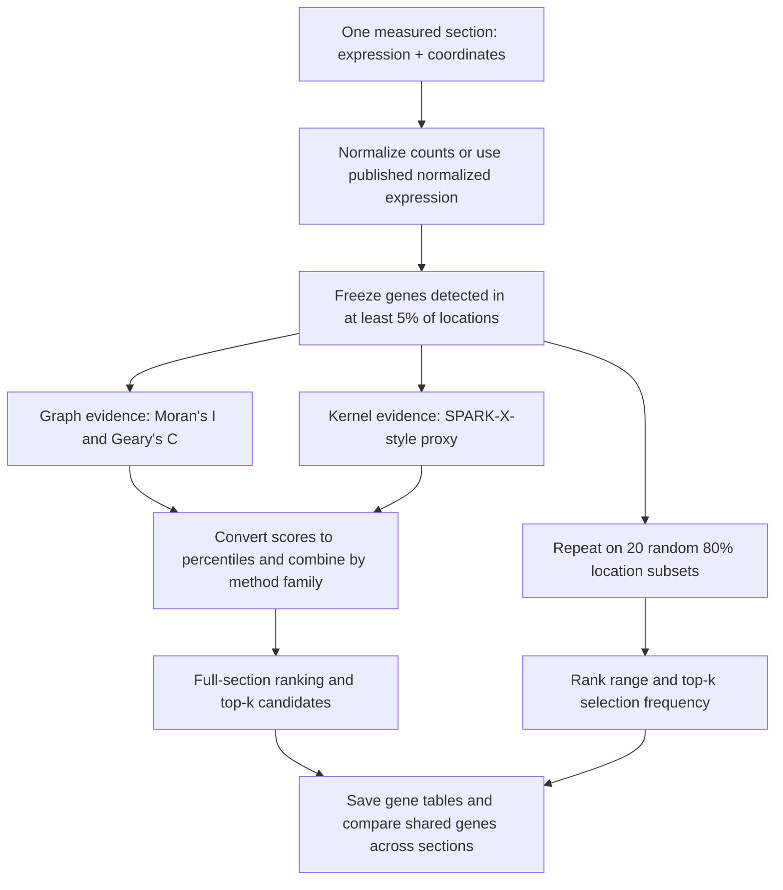

# Direct SVG prediction on measured tissues

The direct runner scores **overall SVG candidates** using the branch's existing spatial statistics and a fixed rank ensemble. It reads each measured section independently. It fits no model, tunes no weights against annotations, and runs no simulation benchmark. The domain-marker pilot has its own [workflow and results](../spatial_benchmark/FRAMEWORK.md).



1. **Prepare each section.** Load the expression matrix and matching coordinates. Visium counts are library-size normalized to 10,000 using the full matrix, then log-transformed. MERFISH uses the published normalized expression followed by a log transform. Exclude zero-total locations and screen genes at 5% detection, keeping at most the 2,000 most detected genes per section.
2. **Score spatial patterns.** Use a six-nearest-neighbor graph for Moran's I and Geary's C. The existing kernel proxy tests several coordinate transformations. Higher Moran's I, lower Geary's C and stronger kernel evidence each favor a higher rank.
3. **Combine the evidence.** Average the two graph percentiles to form one family score. The kernel percentile forms the other. The final score is 75% of the two-family mean plus 25% of the stronger family score. The fixed mixture gives extra weight to strong evidence from one family.
4. **Summarize stability.** Recompute scores on 20 independent draws of 80% of the locations from each measured section. Keep the same eligible genes. Save the 10th, median and 90th percentile ranks and the fraction of perturbations in which a gene stayed in the top 100 (Visium) or top 10 (MERFISH).
5. **Compare sections.** Restrict each within-platform pair to shared eligible genes and compute rank correlation and matched-size overlap. The pairwise lists are re-ranked on the shared universe, so they can differ from the standalone top lists.

## What these predictions support

A gene with high rank and high selection frequency is a candidate that stayed near the top when locations were randomly removed. The readout is conditional on the section, preprocessing and perturbation scheme. MERFISH sections in this run share one animal. Several mitochondrial genes ranked highly in Visium, so spatial QC and a mitochondrial-gene sensitivity analysis matter before interpreting these as biological markers. The kernel proxy uses an approximate, clipped p-value internally as a ranking score, which can tie strong signals.

The published outputs provide candidate rankings and descriptive replication. Formal false-discovery calibration and the official Castl/SPARK-X comparisons are separate parts of the [benchmark protocol](benchmark.md).

## Reproduce this run

Download the exact files listed in the [input configuration](../spatial_benchmark/configs/predict_real.json), keeping the recorded filenames. Verify their SHA-256 digests against the [run manifest](../spatial_benchmark/results/real_predictions/manifest.json). The manifest records package versions.

```bash
cd spatial_benchmark
python -m pip install anndata numpy pandas scipy scikit-learn
python scripts/predict_svg.py --config configs/predict_real.json \
    --data-dir /path/to/input-files --out /path/to/new-output
```

[Stored real-data results](../spatial_benchmark/results/real_predictions/README.md)
