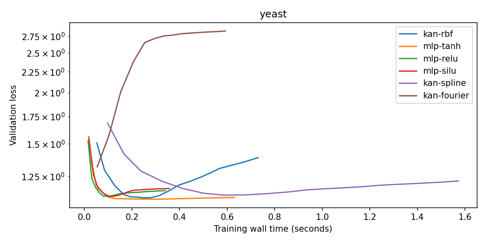
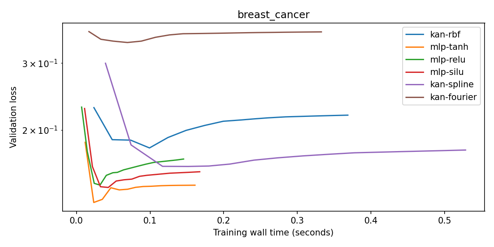
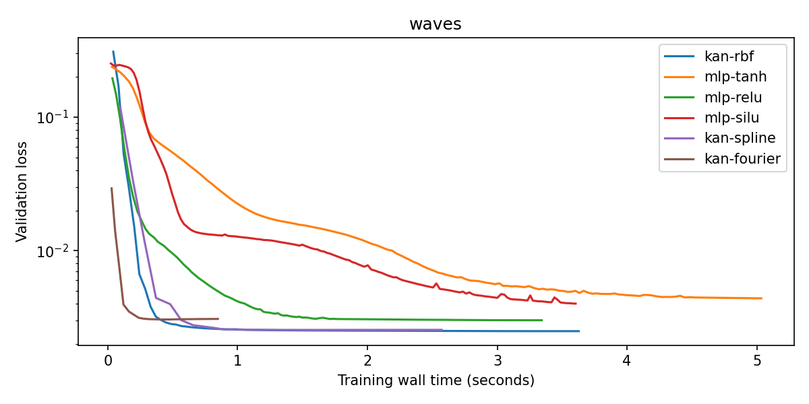
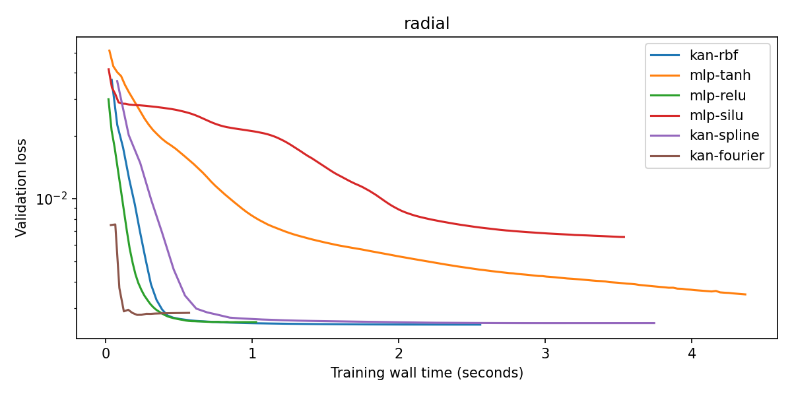

# Measured results

These are actual CPU runs of the code in this repository. Main runs use three seeds, two hidden depths, two candidate learning rates and a maximum of 1,500 epochs per candidate. Pilot runs have a 300-epoch limit and are retained separately. The larger full configs have not been run. The runner trains models sequentially, but the execution host is shared, so timing results are exploratory. Pilot timings were collected while the two pilot studies ran concurrently and should not be used for clean runtime comparisons.

## Biological held-out validation

Each cell uses a stratified 60/20/20 split, training-only standardization and validation-only learning-rate/checkpoint selection. Scores below are internal held-out macro-F1, mean ± SD across three split seeds. They do not establish external cohort or homology-aware generalization.

| Dataset | Hidden layers | Model | Parameters | Macro-F1 | Fit seconds | Search seconds | Plateau / runs |
|---|---:|---|---:|---:|---:|---:|---:|
| yeast | 1 | mlp-tanh | 4095 | 0.5038 ± 0.0925 | 0.5063 ± 0.1071 | 1.0131 ± 0.0527 | 3 / 3 |
| yeast | 1 | mlp-relu | 4095 | 0.5002 ± 0.1072 | 0.3551 ± 0.0246 | 0.6711 ± 0.1149 | 3 / 3 |
| yeast | 1 | mlp-silu | 4095 | 0.5049 ± 0.0935 | 0.4318 ± 0.1297 | 0.7711 ± 0.1967 | 3 / 3 |
| yeast | 1 | kan-spline | 4173 | 0.5272 ± 0.0424 | 1.4863 ± 0.0757 | 2.6829 ± 0.1798 | 3 / 3 |
| yeast | 1 | kan-fourier | 4173 | 0.3978 ± 0.0254 | 0.5943 ± 0.0355 | 1.2424 ± 0.0674 | 3 / 3 |
| yeast | 1 | kan-rbf | 4173 | 0.5303 ± 0.0529 | 0.6958 ± 0.0298 | 1.2455 ± 0.0923 | 3 / 3 |
| yeast | 2 | mlp-tanh | 4098 | 0.5124 ± 0.0859 | 0.3824 ± 0.0607 | 0.8098 ± 0.2126 | 3 / 3 |
| yeast | 2 | mlp-relu | 4098 | 0.4932 ± 0.0948 | 0.3773 ± 0.0955 | 0.6569 ± 0.1652 | 3 / 3 |
| yeast | 2 | mlp-silu | 4098 | 0.4909 ± 0.1029 | 0.3784 ± 0.1074 | 0.6586 ± 0.1532 | 3 / 3 |
| yeast | 2 | kan-spline | 4097 | 0.3910 ± 0.0227 | 1.2586 ± 0.2044 | 2.5234 ± 0.3830 | 3 / 3 |
| yeast | 2 | kan-fourier | 4097 | 0.2733 ± 0.0390 | 0.7026 ± 0.1746 | 1.3628 ± 0.3153 | 3 / 3 |
| yeast | 2 | kan-rbf | 4097 | 0.3938 ± 0.0291 | 0.8779 ± 0.0159 | 1.5806 ± 0.0349 | 3 / 3 |
| breast_cancer | 1 | mlp-tanh | 4094 | 0.9654 ± 0.0217 | 0.1507 ± 0.0234 | 0.2956 ± 0.0202 | 3 / 3 |
| breast_cancer | 1 | mlp-relu | 4094 | 0.9651 ± 0.0294 | 0.1397 ± 0.0050 | 0.2631 ± 0.0141 | 3 / 3 |
| breast_cancer | 1 | mlp-silu | 4094 | 0.9717 ± 0.0189 | 0.1513 ± 0.0193 | 0.2727 ± 0.0283 | 3 / 3 |
| breast_cancer | 1 | kan-spline | 4175 | 0.9432 ± 0.0333 | 0.5300 ± 0.0530 | 0.9948 ± 0.0465 | 3 / 3 |
| breast_cancer | 1 | kan-fourier | 4175 | 0.8608 ± 0.0217 | 0.3252 ± 0.0229 | 0.6243 ± 0.0369 | 3 / 3 |
| breast_cancer | 1 | kan-rbf | 4175 | 0.9498 ± 0.0219 | 0.3615 ± 0.0254 | 0.7042 ± 0.0494 | 3 / 3 |
| breast_cancer | 2 | mlp-tanh | 4096 | 0.9686 ± 0.0145 | 0.1983 ± 0.0542 | 0.3518 ± 0.0720 | 3 / 3 |
| breast_cancer | 2 | mlp-relu | 4096 | 0.9559 ± 0.0278 | 0.1477 ± 0.0261 | 0.2833 ± 0.0354 | 3 / 3 |
| breast_cancer | 2 | mlp-silu | 4096 | 0.9686 ± 0.0145 | 0.1534 ± 0.0243 | 0.2871 ± 0.0243 | 3 / 3 |
| breast_cancer | 2 | kan-spline | 4099 | 0.9496 ± 0.0223 | 0.7676 ± 0.1031 | 1.4366 ± 0.1276 | 3 / 3 |
| breast_cancer | 2 | kan-fourier | 4099 | 0.8829 ± 0.0283 | 0.4543 ± 0.0302 | 0.9065 ± 0.0072 | 3 / 3 |
| breast_cancer | 2 | kan-rbf | 4099 | 0.9561 ± 0.0199 | 0.4875 ± 0.0052 | 0.9218 ± 0.0741 | 3 / 3 |

Fit seconds describe the selected candidate. Search seconds include both learning-rate candidates. Timing includes validation and checkpoint copies; see algorithms.md. Hardware is a shared execution environment, so these timings are descriptive and should be repeated on a dedicated machine before efficiency claims. All biological main-run selected fits reached the validation-plateau rule.

## Synthetic function recovery

Noise-free test RMSE is reported separately for inside [-1,1]^2 and outside [-1.5,1.5]^2 excluding the training square. Lower is better. Means and SDs are across three seeds; training noise SD is 0.05. Same formulas as the HTML, but a separate Python engine.

### Inside-range RMSE

| Target | Hidden layers | MLP tanh | MLP ReLU | MLP SiLU | KAN spline | KAN Fourier | KAN RBF |
|---|---:|---:|---:|---:|---:|---:|---:|
| linear | 1 | 0.0050 ± 0.0013 | 0.0067 ± 0.0007 | 0.0036 ± 0.0012 | 0.0100 ± 0.0013 | 0.0234 ± 0.0020 | 0.0092 ± 0.0016 |
| linear | 2 | 0.0079 ± 0.0017 | 0.0088 ± 0.0018 | 0.0037 ± 0.0003 | 0.0116 ± 0.0017 | 0.0210 ± 0.0034 | 0.0101 ± 0.0019 |
| additive | 1 | 0.0161 ± 0.0020 | 0.0156 ± 0.0012 | 0.0084 ± 0.0005 | 0.0139 ± 0.0007 | 0.0259 ± 0.0016 | 0.0126 ± 0.0018 |
| additive | 2 | 0.0122 ± 0.0006 | 0.0174 ± 0.0008 | 0.0113 ± 0.0013 | 0.0161 ± 0.0017 | 0.0239 ± 0.0027 | 0.0130 ± 0.0005 |
| interaction | 1 | 0.0222 ± 0.0012 | 0.0112 ± 0.0008 | 0.0092 ± 0.0006 | 0.0140 ± 0.0009 | 0.0257 ± 0.0024 | 0.0135 ± 0.0015 |
| interaction | 2 | 0.0120 ± 0.0023 | 0.0157 ± 0.0014 | 0.0073 ± 0.0007 | 0.0152 ± 0.0011 | 0.0226 ± 0.0023 | 0.0134 ± 0.0008 |
| waves | 1 | 0.0502 ± 0.0071 | 0.0258 ± 0.0007 | 0.0570 ± 0.0190 | 0.0166 ± 0.0019 | 0.0278 ± 0.0016 | 0.0138 ± 0.0012 |
| waves | 2 | 0.0256 ± 0.0028 | 0.0263 ± 0.0037 | 0.0241 ± 0.0033 | 0.0174 ± 0.0016 | 0.0294 ± 0.0031 | 0.0153 ± 0.0016 |
| radial | 1 | 0.0376 ± 0.0005 | 0.0173 ± 0.0014 | 0.0683 ± 0.0043 | 0.0122 ± 0.0017 | 0.0236 ± 0.0015 | 0.0109 ± 0.0016 |
| radial | 2 | 0.0170 ± 0.0016 | 0.0161 ± 0.0027 | 0.0211 ± 0.0028 | 0.0110 ± 0.0022 | 0.0217 ± 0.0005 | 0.0104 ± 0.0004 |
| kink | 1 | 0.0210 ± 0.0011 | 0.0090 ± 0.0011 | 0.0227 ± 0.0005 | 0.0141 ± 0.0003 | 0.0231 ± 0.0017 | 0.0143 ± 0.0010 |
| kink | 2 | 0.0141 ± 0.0006 | 0.0089 ± 0.0019 | 0.0191 ± 0.0009 | 0.0138 ± 0.0005 | 0.0242 ± 0.0010 | 0.0128 ± 0.0008 |

### Outside-range RMSE

| Target | Hidden layers | MLP tanh | MLP ReLU | MLP SiLU | KAN spline | KAN Fourier | KAN RBF |
|---|---:|---:|---:|---:|---:|---:|---:|
| linear | 1 | 0.0284 ± 0.0114 | 0.0259 ± 0.0101 | 0.0092 ± 0.0017 | 0.2460 ± 0.0104 | 0.4812 ± 0.0900 | 0.1988 ± 0.0127 |
| linear | 2 | 0.0501 ± 0.0114 | 0.0620 ± 0.0162 | 0.0119 ± 0.0032 | 0.3244 ± 0.0383 | 0.4434 ± 0.0250 | 0.2380 ± 0.0194 |
| additive | 1 | 0.3020 ± 0.0217 | 0.1410 ± 0.0119 | 0.3074 ± 0.0604 | 0.7646 ± 0.0102 | 0.9647 ± 0.0237 | 0.4649 ± 0.0214 |
| additive | 2 | 0.2095 ± 0.0121 | 0.1582 ± 0.0281 | 0.3449 ± 0.0302 | 0.7589 ± 0.0147 | 0.9726 ± 0.0625 | 0.4967 ± 0.0120 |
| interaction | 1 | 0.2650 ± 0.0102 | 0.2256 ± 0.0064 | 0.1026 ± 0.0018 | 0.6723 ± 0.0258 | 0.9460 ± 0.0641 | 0.5373 ± 0.0307 |
| interaction | 2 | 0.2615 ± 0.0230 | 0.2965 ± 0.0093 | 0.0796 ± 0.0110 | 0.7904 ± 0.0474 | 0.8890 ± 0.1760 | 0.6267 ± 0.0304 |
| waves | 1 | 0.4993 ± 0.0897 | 0.3322 ± 0.0184 | 0.4624 ± 0.1310 | 0.4722 ± 0.0756 | 0.6046 ± 0.0357 | 0.2922 ± 0.0351 |
| waves | 2 | 0.4257 ± 0.0075 | 0.4130 ± 0.0415 | 0.3526 ± 0.0162 | 0.4791 ± 0.0355 | 0.5760 ± 0.0214 | 0.3436 ± 0.0381 |
| radial | 1 | 0.1817 ± 0.0101 | 0.1078 ± 0.0151 | 0.4016 ± 0.0350 | 0.0999 ± 0.0186 | 0.1393 ± 0.0168 | 0.0717 ± 0.0208 |
| radial | 2 | 0.0902 ± 0.0104 | 0.0901 ± 0.0394 | 0.0819 ± 0.0217 | 0.0873 ± 0.0057 | 0.1448 ± 0.0716 | 0.0403 ± 0.0021 |
| kink | 1 | 0.0824 ± 0.0045 | 0.0295 ± 0.0100 | 0.0392 ± 0.0082 | 0.1969 ± 0.0094 | 0.4791 ± 0.0907 | 0.1587 ± 0.0073 |
| kink | 2 | 0.0765 ± 0.0060 | 0.0348 ± 0.0099 | 0.0512 ± 0.0050 | 0.2560 ± 0.0138 | 0.3859 ± 0.0624 | 0.2060 ± 0.0114 |

### Optimization status

{'validation_plateau': 187, 'epoch_limit': 29}

Epoch-limit runs are **not converged results**. Inspect per-run histories and raise limits before interpreting an apparent representational disadvantage. No test data were used to decide which checkpoint or learning rate to select.

## Selected figures

## What these experiments can support

- Differences are conditional on a fixed-grid KAN implementation, chosen parameter budgets and a two-value learning-rate search. No result establishes that all KANs or MLPs behave the same way.
- A local basis can help recover a localized toy response, but extrapolation and real biological prediction are separate questions.
- Compare depth within budget as well as model family within depth. Hidden-layer count does not equalize the number or flexibility of nonlinear operations.
- Three resampled splits are too few for strong statistical claims. Paired bootstrap intervals in CSV files are descriptive and do not account for overlapping test subjects across split seeds.
- Real periodic gene expression, localized dose windows, biological extrapolation and independent external cohorts remain proposed extensions.

## Inspect and reproduce

Each results directory includes metrics.csv, summary.csv, paired_differences.csv, validation-time curves, per-model histories, split metadata and environment.json. Training checkpoints are generated locally and excluded from Git. Re-run the configs to regenerate them. Initial environment records may have null commit IDs because collection preceded repository initialization.
