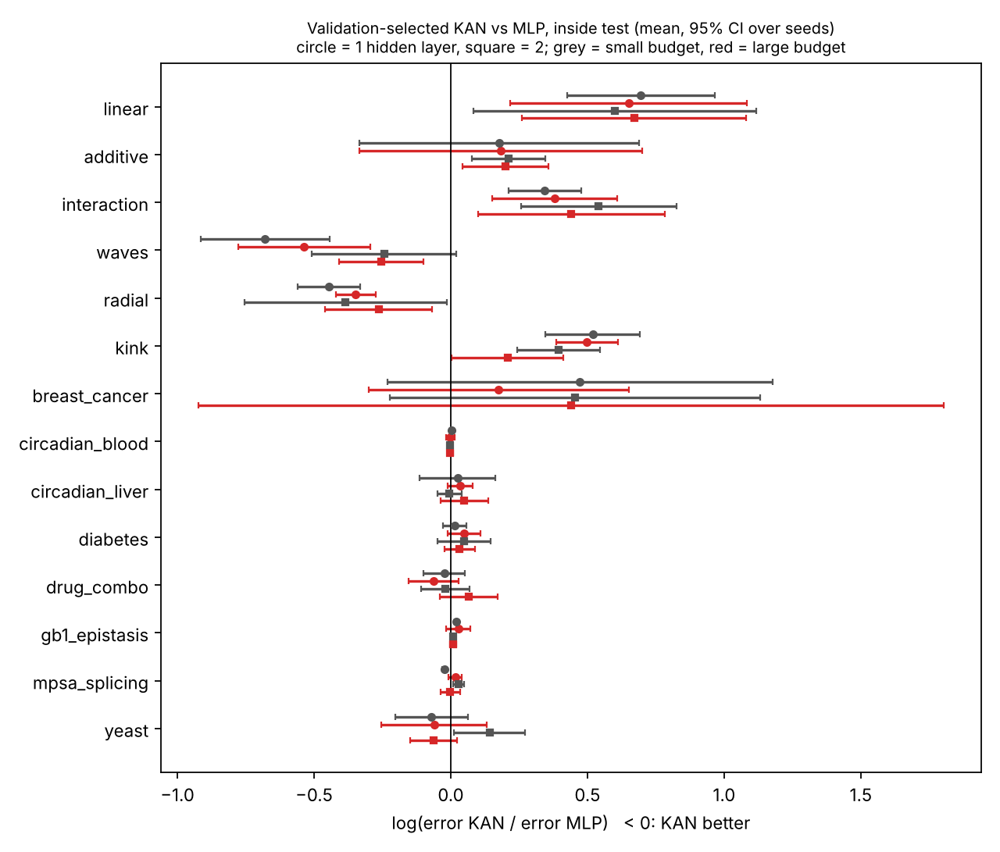
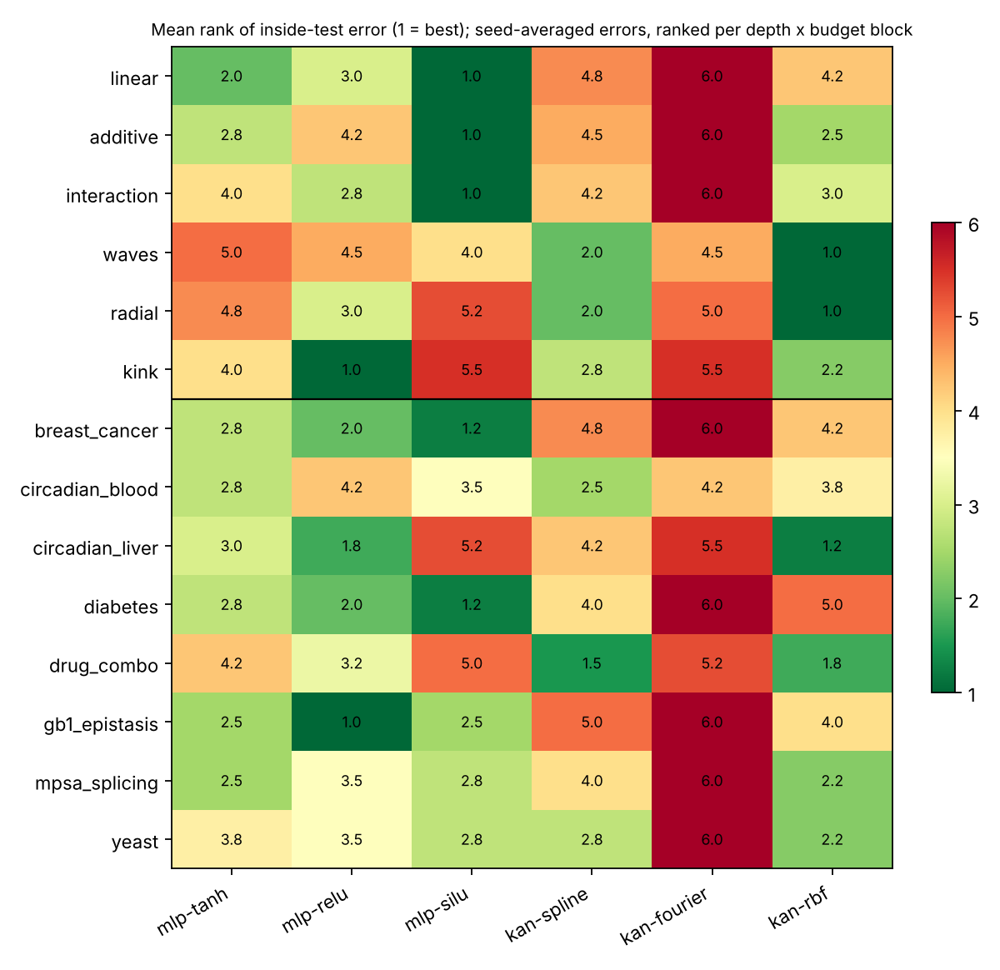
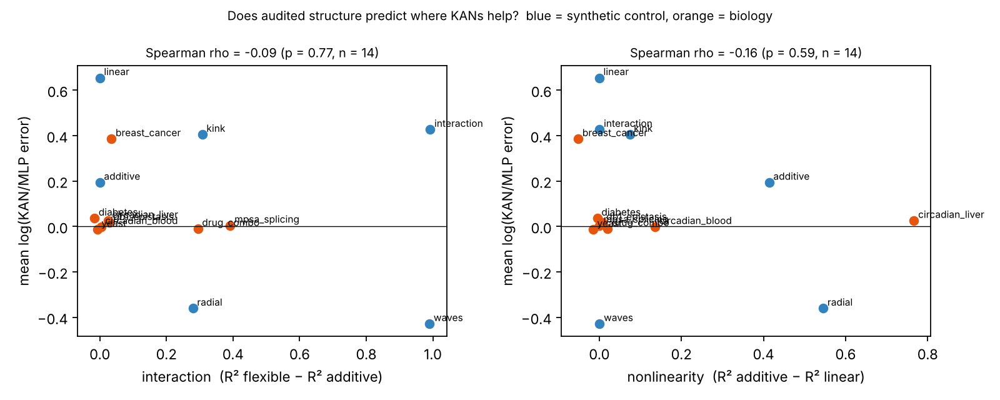
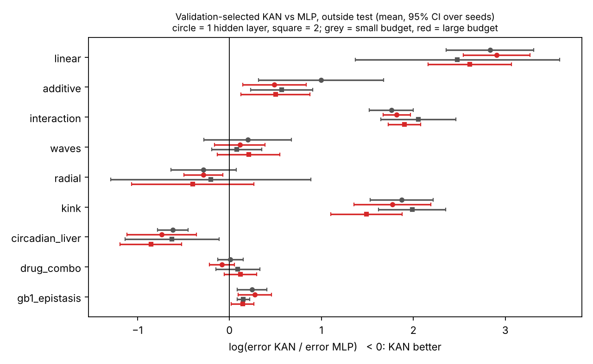
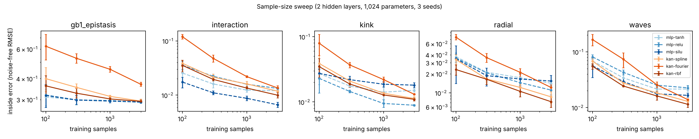
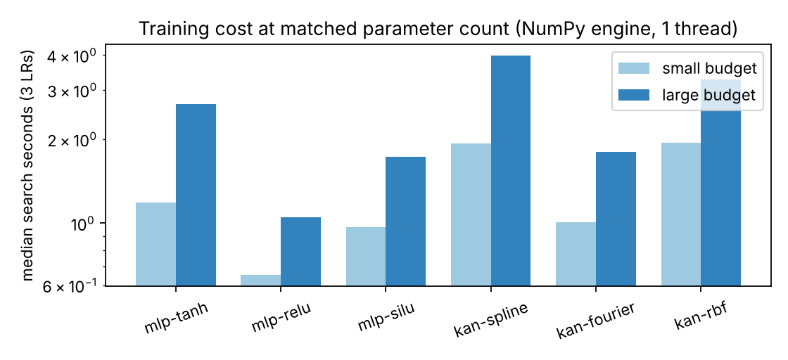

# v2 results: KAN versus parameter-matched MLP across 14 tasks

The protocol is in [research_design.md](research_design.md) and the data checks are in [structure_audit.md](structure_audit.md). Every number below is regenerated by `make v2-report` from the run records in [`results/v2/records_v2.zip`](../results/v2/records_v2.zip). Unzip it inside `results/v2/` before re-running the analysis.

## Summary

1. **At equal parameter count (±2 %), KANs and MLPs are statistically indistinguishable on every biological task.** The validation-selected KAN/MLP error ratio ranges from 0.99 to 1.04 on the eight biological tasks. The one larger gap, breast cancer at 1.47, has a CI of 0.90–2.21. Three of the five structure-selected tasks were *confirmed* by the audit to have periodic or interaction structure, and still showed no benefit.
2. **KANs do win on two synthetic structures, oscillatory interaction (`waves`) and a localized bump (`radial`).** There the error ratio is about 0.65–0.70, with the KAN winning 20/20 and 19/20 paired blocks. On linear, additive, product-interaction and threshold (`kink`) targets they *lose* by 1.2–1.9×. The RBF basis wins most often, which fits these two structures being local in shape.
3. **The audit's general interaction and nonlinearity scores do not predict where KANs help.** Spearman ρ is −0.09 and −0.16 across tasks. What predicts a gain is a specific geometry: bumps and oscillations in a low-dimensional input space. None of the biological tasks presents that geometry in a form a fixed-grid KAN can exploit at these sample sizes.
4. **Extrapolation is mostly a KAN weakness.** Outside the training range, KAN error is 1.9–15× the MLP error on the linear, additive, interaction and kink controls, and 1.23× on GB1. The two exceptions are not real successes:
   - On `radial` the target decays to zero, and so does the RBF basis. Yet *both* families are worse than predicting zero.
   - On the liver forecast, KANs halve the MLP error (1.5 vs 3.2 SD). But every network is worse than predicting the mean (1.26 SD), and a two-harmonic cosinor reaches 0.66 SD.
5. **Fourier KANs are the worst model overall,** with a mean rank of 5.57/6. Aligning the Fourier period with the 24 h biological period did not fix this on the circadian data.
6. **Cost.** At equal parameters, KANs took about 1.7× longer to train (median search time) and about 4× longer per prediction, despite having almost identical multiply–accumulate counts.

These conclusions hold under robustness checks. Retraining all 37 epoch-capped runs with a 15,000-epoch cap changed no headline ratio by more than 0.012, and changed no win count.

## Run inventory

| Study | Runs | Stopped on validation plateau | Max parameter mismatch |
|---|---:|---:|---:|
| Main (14 tasks × 6 models × 2 depths × 2 budgets × 5 seeds, or 12 drug blocks) | 1,848 | 1,811 (98.0 %) | 1.93 % (KANs), 0.59 % (MLPs) |
| Sample-size sweep (5 tasks × 4 sizes × 6 models × 3 seeds) | 360 | — | — |
| Period-alignment ablation (2 tasks) | 240 | — | — |
| Epoch-cap robustness rerun | 37 | 37 / 37 | — |

No learning-rate candidate diverged. The engine and its checks are described in [research_design.md](research_design.md#implementation-note-numpy-engine). CI verifies it against the PyTorch models to 1e-8.

## 1. Headline: validation-selected KAN vs MLP per task

In each (task, replicate, depth, budget) block, the KAN basis and the MLP activation are each chosen by validation loss. Their test errors are then compared.
- **Ratio:** exp(mean log(KAN error / MLP error)). Below 1 means the KAN is better.
- **CI:** a 95 % bootstrap over replicate seeds.
- **Error:** noise-free RMSE for synthetic tasks (their own units), RMSE in target-SD units for biological regression, and 1 − macro-F1 for classification.
- **Baselines:** the training-mean predictor and ridge regression; for circadian tasks, also a 24 h + 12 h cosinor.

| Task | Audited structure | Inside ratio (95 % CI) | KAN wins | KAN / MLP error | Mean / ridge baseline | Outside ratio (95 % CI) | KAN wins | KAN / MLP error | Mean / ridge baseline |
|---|---|---|---:|---|---|---|---:|---|---|
| linear | near-linear | 1.924 (1.610–2.298) | 0/20 | 0.010 / 0.005 | 0.551 / 0.002 | 14.99 (11.50–19.55) | 0/20 | 0.222 / 0.018 | 0.976 / 0.003 |
| additive | nonlinear marginals | 1.214 (1.050–1.384) | 4/20 | 0.013 / 0.011 | 0.747 / 0.469 | 1.893 (1.529–2.316) | 0/20 | 0.498 / 0.273 | 0.966 / 1.546 |
| interaction | interaction | 1.532 (1.409–1.648) | 0/20 | 0.014 / 0.009 | 0.504 / 0.504 | 6.578 (6.011–7.199) | 0/20 | 0.624 / 0.096 | 1.437 / 1.437 |
| **waves** | periodic interaction | **0.652 (0.564–0.732)** | **20/20** | 0.015 / 0.023 | 0.502 / 0.502 | 1.162 (0.994–1.345) | 5/20 | 0.382 / 0.330 | 0.504 / 0.505 |
| **radial** | localized bump | **0.697 (0.644–0.780)** | **19/20** | 0.010 / 0.015 | 0.279 / 0.218 | 0.748 (0.625–0.873) | 15/20 | 0.068 / 0.087 | 0.006 / 0.213 |
| kink | threshold + interaction | 1.499 (1.377–1.632) | 1/20 | 0.014 / 0.009 | 0.499 / 0.236 | 5.935 (5.015–7.130) | 0/20 | 0.199 / 0.034 | 0.914 / 0.479 |
| breast_cancer | near-linear (classification) | 1.471 (0.901–2.211) | 4/20 | 0.040 / 0.027 | — | — | | | |
| circadian_blood | 24 h rhythm within subjects; low across subjects | 0.999 (0.997–1.001) | 9/20 | 1.011 / 1.012 | 1.092 / 1.061 (cosinor 0.999) | — | | | |
| circadian_liver | strongly periodic | 1.026 (0.978–1.071) | 7/20 | 0.538 / 0.526 | 1.142 / 1.125 (cosinor **0.487**) | 0.492 (0.465–0.531) | 20/20 | 1.545 / 3.219 | 1.258 / 1.256 (cosinor **0.663**) |
| diabetes | near-linear | 1.037 (0.999–1.065) | 5/20 | 0.728 / 0.702 | 0.957 / 0.696 | — | | | |
| drug_combo | interaction + thresholds | 0.990 (0.946–1.025) | 22/48 | 0.598 / 0.600 | 0.954 / 0.756 | 1.036 (0.928–1.143) | 21/48 | 0.875 / 0.835 | 1.668 / 1.277 |
| gb1_epistasis | weak interaction (training range) | 1.017 (1.007–1.026) | 2/20 | 0.305 / 0.300 | 0.999 / 0.360 | 1.226 (1.142–1.313) | 0/20 | 0.392 / 0.319 | 1.878 / 0.919 |
| mpsa_splicing | interaction (binary inputs) | 1.005 (0.996–1.014) | 8/20 | 0.597 / 0.594 | 0.954 / 0.864 | — | | | |
| yeast | near-linear (classification) | 0.987 (0.918–1.050) | 10/20 | 0.475 / 0.480 | — | — | | | |

The per-depth, per-budget version of this table, with Wilcoxon and Holm-adjusted p-values, is in [`results/v2/main/tables.md`](../results/v2/main/tables.md). With five replicates the smallest attainable two-sided Wilcoxon p is 0.0625, so no single depth × budget cell survives Holm correction across the 56 cells. The evidence is the consistency across cells (e.g. 20/20 wins on `waves`), the seed-bootstrap CIs, and the replication across depth and budget, not any single test.

### How to read the biological rows

- **Liver forecast.** This is the only biological "KAN win", and it is misleading. MLPs extrapolate the last trend and diverge (3.2 SD). KAN edges flatten outside their grid, which keeps errors smaller. Still, *every* network forecasts worse than the training mean (1.26 SD), and the two-harmonic cosinor reaches 0.66 SD. On 24 time points, the right parametric model beats both families by 2–5×.
- **Blood transcripts.** Every model sits at ≈1.01 SD, the same as the cosinor reference. The audit explains why: the rhythm is clear *within* each person (cosinor q < 1e-26), but person-to-person offsets dominate *across* people. No architecture can recover the offset of an unseen person from time alone.
- **Drug combinations.** KAN and MLP are tied (0.99 inside, 22/48 wins). Both beat ridge (0.76) clearly, which confirms that the surface carries learnable interaction and threshold structure. KAN edges simply give no extra benefit with 49 training wells.
- **GB1.** The MLP is slightly but consistently better inside the training range (1.017, CI excludes 1). It is clearly better on pairs with a strongly deleterious mutation (1.23, 0/20 KAN wins). This is the region where the audit located the epistasis, so the result runs *against* the KAN hypothesis.
- **Splice sites.** A tie (1.005). On ±1 one-hot inputs a learned edge function only matters at two points, so a KAN has no shape advantage to exploit.

## 2. All six models

Mean rank of seed-averaged inside error over 56 (task, depth, budget) blocks. Friedman χ² = 88.2, p = 1.6e-17; the Nemenyi critical difference is 1.01 ranks.

| Model | Mean rank |
|---|---:|
| kan-rbf | 2.75 |
| mlp-relu | 2.84 |
| mlp-silu | 3.00 |
| mlp-tanh | 3.34 |
| kan-spline | 3.50 |
| kan-fourier | 5.57 |

The RBF KAN, ReLU MLP, SiLU MLP and tanh MLP are within one critical difference of each other. The Fourier KAN is significantly worse than every other model.

When validation picks the KAN basis, it chooses RBF in 198 of 308 blocks, spline in 97 and Fourier in only 13. For the MLP it chooses ReLU 121 times, SiLU 105 and tanh 82.

## 3. Does audited structure predict the KAN advantage? (RQ2)

No. Across the 14 tasks, the mean log ratio has no meaningful correlation with the audited interaction score (Spearman ρ = −0.09, p = 0.77) or with the nonlinearity score (ρ = −0.16, p = 0.59).
- **Interaction:** `interaction` and `waves` both have an interaction score of 0.99, yet KANs lose on the first (1.53) and win on the second (0.65).
- **Biology:** the biological tasks span interaction scores from 0 to 0.39 and sit on the zero line.

What separates the two KAN wins is *shape*. Both targets have oscillations or a bump inside the [−1, 1]² grid, which local RBF and spline edge functions can tile. A smooth product (`interaction`) or a ridge (`kink`) is instead represented more cheaply by the wide MLP that the same parameters buy, about ten times as many hidden units.

## 4. Extrapolation (RQ3)

KAN edges are fixed-grid local bases plus a SiLU path, so outside [−1, 1] they revert to an almost linear SiLU response with no trained curvature. Where the true function keeps its trend (linear, kink, interaction, additive, GB1), MLPs extrapolate that trend and KANs do not. The cost to KANs is large: 1.9× to 15× the MLP error.

Where the true function returns to a constant (the bump) or oscillates (the circadian forecast), the KANs' flattening is *less wrong* than the MLPs' trend-following. Neither family captures the true behaviour. On `radial`, predicting zero gives 0.006 versus 0.068 (KAN) and 0.087 (MLP).

## 5. Sample size (RQ4)

These runs use 2 hidden layers, 1,024 parameters and 3 seeds. The table gives the validation-selected KAN/MLP error ratio at each training-set size.

| Task | n = 100 | 300 | 1,000 | 3,000 |
|---|---:|---:|---:|---:|
| waves | 1.06 | 0.84 | 0.91 | 0.69 |
| radial | 0.86 | 0.97 | 0.73 | 0.82 |
| kink | 1.65 | 1.32 | 1.44 | 1.35 |
| interaction | 2.04 | 1.77 | 1.56 | 1.78 |
| gb1_epistasis | 1.17 | 1.09 | 1.02 | 1.01 |

The KAN advantage on oscillatory structure *grows* with data. At 100 samples it is gone, which matters because most of the biological tasks here have 24–300 training points. On GB1 the KAN deficit shrinks towards parity as n grows. The KAN penalties on `kink` and `interaction` persist at every size.

## 6. Ablation: aligning the Fourier period with 24 h

By default, time is min-max scaled to [−1, 1], so the Fourier basis period of 2 input units corresponds to about 35 h on the liver data. In the aligned variant, 24 h = 2 input units, giving harmonics at 24, 12, 8 and 6 h. Errors below are RMSE in target-SD units, means over depth, budget and seeds.

| Model | Liver inside, default | Liver inside, aligned | Liver forecast, default | Liver forecast, aligned |
|---|---:|---:|---:|---:|
| mlp-tanh | 0.530 | 0.536 | 2.232 | 2.258 |
| mlp-relu | 0.522 | 0.526 | 3.388 | 3.519 |
| mlp-silu | 0.650 | 0.567 | 4.098 | 4.367 |
| kan-spline | 0.548 | 0.546 | 1.453 | 1.435 |
| kan-fourier | 0.601 | 0.692 | 1.442 | 1.406 |
| kan-rbf | 0.524 | 0.543 | 1.661 | 1.566 |
| *cosinor reference* | 0.487 | | 0.663 | |

Alignment did **not** help the Fourier KAN. Its inside error got worse, and its forecast stayed at 1.4 SD versus 0.66 for the cosinor. Blood results were unchanged for all models (1.011–1.016 SD). A periodic first-layer basis cannot make the whole network periodic, for two reasons:
- each edge also carries a non-periodic SiLU term;
- deeper layers apply non-periodic functions to its output.

The basis–structure match that motivates KANs therefore does not carry through the architecture as implemented (the standard SiLU + basis edge).

Full table: [`results/v2/ablation_period/period_alignment.md`](../results/v2/ablation_period/period_alignment.md).

## 7. Robustness: epoch cap

37 of 1,848 runs (2.0 %) hit the 3,000-epoch cap, all of them MLPs, and 24 of them on `waves`. Each was retrained at its selected learning rate with a 15,000-epoch cap, and all 37 then stopped on the validation plateau. Some individual tanh/SiLU MLPs improved considerably, e.g. 0.046 → 0.024 on `waves`. The validation-selected comparison barely moved:

| Task | Capped runs | Inside ratio, 3,000-epoch cap | After retraining to 15,000 | KAN wins |
|---|---:|---|---|---|
| waves | 24 | 0.652 (0.564–0.732) | 0.664 (0.568–0.756) | 20/20 → 20/20 |
| radial | 6 | 0.697 (0.644–0.775) | 0.697 (0.644–0.775) | 19/20 → 19/20 |
| interaction | 2 | 1.532 | 1.532 | 0/20 → 0/20 |
| drug_combo | 3 | 0.990 | 0.991 | 22/48 → 22/48 |
| kink, circadian_liver | 1 each | unchanged | unchanged | unchanged |

The selected MLP is usually ReLU, which converges quickly, so the capped tanh/SiLU runs rarely decided a comparison.

## 8. Cost at matched parameters

| | KAN | MLP | KAN / MLP |
|---|---:|---:|---:|
| Median MACs per sample | 3,974 | 3,740 | 1.06 |
| Median search time, small budget (3 learning rates, s) | 1.36 | 0.79 | 1.7 |
| Median search time, large budget (s) | 2.62 | 1.50 | 1.7 |
| Median prediction time (µs per sample) | 2.49 | 0.63 | 4.0 |

MAC counts are nearly equal, but the 8 basis evaluations per edge (exp, sin/cos, piecewise cubic) and the (batch × inputs × 8) basis tensors make KANs slower in practice. Timings come from one shared 2-core cloud host using the NumPy engine with 1 BLAS thread per worker. They are indicative only.

## What this means for the biological questions

- **"Do KANs help on biological data with the structure they were designed for?"** Not in this study. That holds for rhythms, dose–response surfaces and sequence–function maps alike. Where the structure was confirmed, the models tied. Where the structure lay in an extrapolation region (GB1), MLPs were better.
- **"Is the data really the type we expected?"** Only partly, and checking mattered:
  - GB1's epistasis is invisible in the training range;
  - the blood rhythm is real but mostly person-specific;
  - drug surfaces have the expected interaction, but over too few wells to separate learners.

  Without the audit, a tie on GB1 could have been misread as "KANs cannot exploit global epistasis". The audit shows there was little epistasis to exploit inside the training range.
- **Where would a KAN advantage be worth pursuing?** The synthetic results point to low-dimensional inputs with bumps or oscillations inside the training range and ≥ 300–1,000 samples. Candidates include spatial expression over tissue coordinates with donor-held-out validation, or dense dose × time response surfaces. The 10-gene MetaCycle subsets and the 10 × 10 drug matrices used here are too small.
- **For rhythmic data,** a parametric periodic model (cosinor) remains the right baseline. It beat both architectures by a wide margin.

## Limitations

- **Simplified KAN.** These are fixed-grid KANs (8 basis terms on [−1, 1]) with no grid extension, pruning or symbolic fitting. Adaptive grids could change the extrapolation results in particular.
- **Limited tuning.** Only the learning rate is tuned (3 values per model). Grid size, weight decay and width/depth allocation are fixed.
- **Small biological datasets.** Liver has 24 training points, drug screens 49 wells per block, and the circadian sets are 10-gene subsets. Biological effect sizes would need to exceed ≈ 5 % to be detected reliably.
- **Few replicates.** With 5 replicates per cell, per-cell tests cannot reach significance after correction. Conclusions rest on cross-cell consistency and seed-bootstrap CIs.
- **Different engine from v1.** v2 uses a NumPy engine that matches the v1 PyTorch models (verified in CI) but draws different random streams, so v1 and v2 numbers are not interchangeable.
- **Code version.** The main run's `environment.json` records the pre-v2 base commit, because the v2 code was committed after the runs. The code used is the v2 code in this branch at commit `44122c1` and later. Only tests and analysis scripts changed after the runs.
