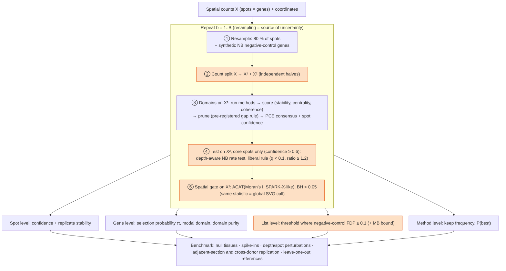
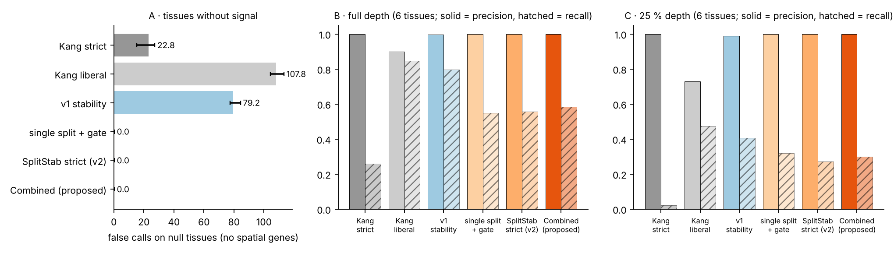
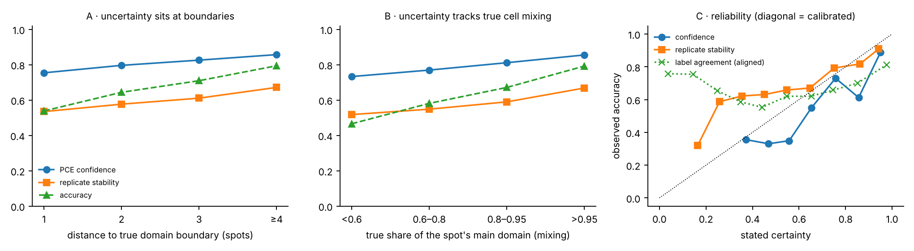
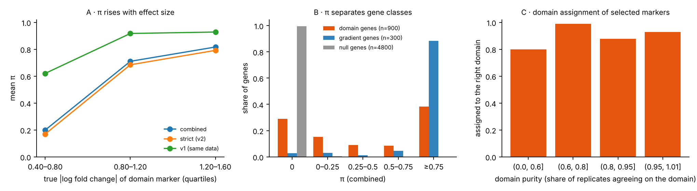
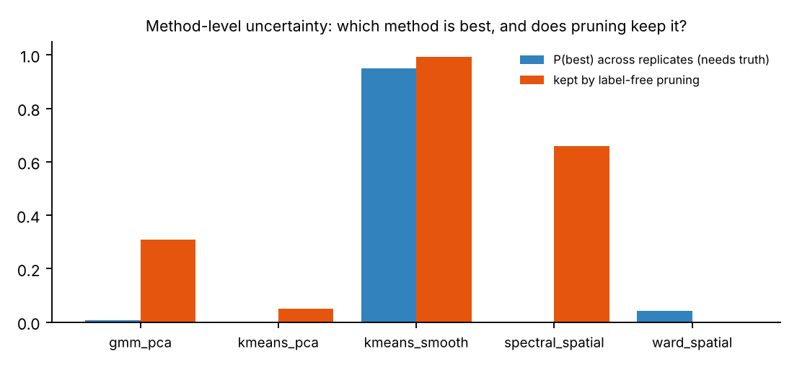

# Uncertainty-aware identification of domain-specific spatially variable genes

**One framework combining v1 (proposal + pilot) and v2 (expansion + validation)**

Branch `spatial-svg-benchmark` · BIOINF 590 · reference benchmark: Kang et al., *Nucleic Acids Research* 53, gkaf303 (2025)

This document replaces `PROPOSAL.md` (v1) and `REPORT_v2.md` (v2) as the single description of the project. Both are kept for history.

## 1. The problem in one paragraph

In spatial transcriptomics a common workflow is: find spatial domains (for example cortical layers), then find genes that mark each domain. Kang et al. (2025) benchmarked 19 methods for both steps and found that no domain method wins everywhere. Their remedy was a majority vote over methods, followed by the SpaGCN marker rule. That workflow has four weak points:

1. **Method choice is a hidden source of variation.** A majority vote gives every method an equal say and returns hard labels with no confidence.
2. **Double dipping.** The same counts are used to draw the domains and to test for genes that differ between them. Clustering has already separated spots that differ, so genes with no spatial pattern look like domain markers.
3. **No error rate.** The list of domain markers comes with no estimate of how many entries are false. The authors themselves note the pipeline can over-produce SVGs.
4. **A circular reference.** On real data, "true" SVGs are the intersection of three of the tested methods, so methods inside the reference are flattered.

Our framework addresses all four, and attaches an uncertainty statement to every output: each spot, each gene, the list, and the method ranking.

## 2. Workflow

*Combined workflow. Orange boxes are the steps that are new relative to Kang et al. and to prior ensemble and aggregation methods.*

The framework is one loop repeated B times (B = 20 by default). Each replicate:

1. **Resample.** Keep a random 80 % of spots. Append synthetic negative-control genes (§3.5).
2. **Count split.** Split every count into two independent halves, X¹ and X² (§3.2).
3. **Domains on X¹.** Run every domain method, score each method without labels, prune the weak ones, and build a weighted consensus with a per-spot confidence. This step is **PCE** (§3.1).
4. **Marker test on X²**, using only core spots (confidence ≥ 0.6). The test is a depth-aware negative-binomial rate test with a permissive per-replicate rule (§3.3).
5. **Spatial gate on X².** A gene must also be spatially variable (§3.4). The same statistic gives that replicate's global SVG call.

After B replicates:

- **Spot level:** confidence (do the kept methods agree?) and replicate agreement (does the spot keep its domain when the tissue is resampled?).
- **Gene level:** selection probability π (share of replicates calling the gene), modal domain, and domain purity (how consistently it is assigned to that domain).
- **List level:** a π threshold chosen so that the estimated false-discovery proportion, measured on the negative controls, is ≤ 0.1. The Meinshausen–Bühlmann bound is reported alongside.
- **Method level:** how often each method is kept by pruning and, where truth exists, how often it is the best (P(best)).

The benchmark then checks these outputs on tissues with no signal, on spike-ins, under depth and spot perturbations, between adjacent sections and between donors, and against leave-one-out references.

## 3. Methods

### 3.1 PCE: pruned confidence-aware ensemble (from v1, refined in v2)

- **Members.** Each method runs R times (new seed; later runs use 0.8 binomial thinning and a small coordinate jitter).
- **Label-free scores.** Stability (ARI across a method's own runs), centrality (mean ARI to other methods) and spatial coherence (share of neighbours with the same label). Each is z-scored across methods and averaged.
- **Pruning.** Sort scores and cut at the first gap larger than 1.0 z, keeping 2–3 methods. The rule was fixed on pilot tissues (seeds 1–3) and never re-tuned.
- **Consensus.** A weighted co-association matrix over kept members, spectral clustering with spatial smoothing.
- **Confidence.** For each spot, the weighted share of kept member runs that agree with the consensus.

### 3.2 Count splitting (v2)

For negative-binomial counts with gene-wise size β,
$$X^{(1)} \mid X \sim \mathrm{BetaBinomial}(X,\ \varepsilon\beta,\ (1-\varepsilon)\beta),\qquad X^{(2)} = X - X^{(1)},\qquad \varepsilon = 0.5 .$$
The two halves are independent draws of the same expression profile (Neufeld et al. 2023–2024). Domains are found on X¹ and markers tested on X², so the test cannot reuse the clustering's choices. Biologically, this is like sequencing the same tissue twice at half depth.

### 3.3 Depth-aware marker test on core spots (v2, rule from v1)

For gene g and domain d, with size factors s from X²,
$$r = \frac{\sum X}{\sum s},\qquad \operatorname{Var}\log r \approx \frac{1}{r S} + \frac{\sum s^2}{\beta S^2},\qquad z = \frac{\log r_{\text{in}} - \log r_{\text{out}}}{\sqrt{V_{\text{in}} + V_{\text{out}}}} .$$
One-sided, BH per domain. Only core spots (confidence ≥ 0.6) are compared, so ambiguous boundary spots neither dilute a real contrast nor create a fake one.

The **per-replicate rule is permissive** (q < 0.1, rate ratio ≥ 1.2). This is the main change from v2 and comes from v1. v1 showed that a permissive rule plus stability selection has high recall. v2 showed that a strict rule makes stability redundant: each replicate is already so conservative that π only repeats the same calls. In the combined framework, error control is the job of the split, the gate and the negative controls, not of a strict per-replicate rule.

The test replaces the SpaGCN rule's "detected in ≥ 80 % of in-domain spots", which collapses at low depth.

### 3.4 Spatial gate = global SVG reference (v1 idea, v2 placement)

On X², combine Moran's I and a SPARK-X-like kernel test by the Cauchy combination (ACAT), then BH. A domain marker must pass (q < 0.05).

Why it is needed: domain callers partly cluster by **cell state** (for example activated vs resting cells scattered through the tissue). Genes of that state truly differ between clusters, even on independent counts, but have no spatial pattern. Count splitting cannot remove them; only a spatial requirement can.

In v1 the same ACAT statistic was proposed as the global SVG reference that replaces the circular intersection. In the combined framework the two jobs share one computation.

### 3.5 Negative controls and the list threshold (v2)

Each replicate carries 10 % extra synthetic genes drawn from NB(μ_g s_i, β_g), using real genes' means and dispersions and the **real per-spot size factors**. They have the slice's depth structure but no biology. Permuted genes (as in Castl) would destroy the depth structure and underestimate depth-driven false calls.

The list threshold is the smallest t ∈ {0.5, 0.55, …, 1} with
$$\widehat{\mathrm{FDP}}(t) = \frac{\#\{\text{controls with } \pi \ge t\}\cdot G/G_{\text{nc}}}{\max(1,\ \#\{\text{genes with } \pi \ge t\})} \le 0.1 .$$

## 4. What is new, and why we think it is better

| Component | Prior work | What we add | Why it should be better |
|---|---|---|---|
| Domain consensus | Majority vote (Kang); EnSDD learned weights; STCC consensus; SpatialESD selection | Pre-registered **pruning** + per-spot confidence that is **used downstream** | Bad methods get no vote; boundary spots are kept out of marker tests. *Gain is modest (§6.4).* |
| Double dipping | Recognised for scRNA-seq (ClusterDE, count splitting) | Count splitting inside a **spatial domain → marker** pipeline | Removes markers created by the clustering itself |
| Non-spatial confounding | Not addressed for domain markers | **Spatial gate** on the held-out half | Removes cell-state genes that survive splitting |
| Error rate of domain-marker lists | None (Kang); global lists only (Castl) | **Stability selection with depth-preserving negative controls** for *domain-specific* SVGs | Every list comes with an estimated FDP; each gene with a π |
| Low depth | SpaGCN rule needs ≥ 80 % detection | Depth-aware **rate** test | Keeps recall when reads are scarce |
| Reference for evaluation | Intersection of methods (circular) | ACAT reference, leave-one-out check, truth-anchored nulls and spike-ins | Fair to methods outside the reference |
| Uncertainty | None reported | Spot, gene, list and method levels, each checked against something biological or known (§7) | Users can tell which calls to trust |

The single most important claim: **the combined method returns domain-specific SVG lists whose false-call rate is controlled, while keeping more true markers than the strict published rule, including at low depth.** The ensemble and global parts support this claim but are not claimed as large improvements on their own.

## 5. What has been done: v1 → v2 → combined

| Stage | What it contained | What it taught us |
|---|---|---|
| **v1: proposal + pilot** (`PROPOSAL.md`, `results/pilot/`) | Weighted co-association ensemble with label-free scores and pruning; ACAT global reference replacing the intersection; stability selection of domain SVGs with a liberal SpaGCN rule; perturbation grid (depth, spot loss, coordinate error). Simulated tissues, seeds 1–3. | Ensemble ≥ majority vote; the intersection reference misses ~⅓ of true SVGs; depth is what breaks domain-SVG calling; liberal rule + stability has high recall. |
| **v2: expansion + validation** (`REPORT_v2.md`, `results/validation/`) | Gap analysis vs EnSDD, STCC, SpatialESD, Castl, InSTability, ClusterDE. Count splitting, depth-aware NB test, spatial gate, depth-preserving negative controls (SplitStab). EnSDD/STCC/Castl baselines. Held-out seeds 4–6 and null tissues. Real-data pipeline + Colab. | Same-data pipelines produce many false markers on tissues with no signal; splitting alone is not enough (cell-state genes); the gate removes the rest. PCE's advantage over majority vote is not reliable. |
| **Combined** (this document, `results/combined/`) | v2's validity machinery with v1's permissive per-replicate rule; one spatial statistic for gate and global list; alignment-free spot stability; full ablation; uncertainty validated at spot, gene, list and method level; real-data uncertainty checks (boundaries, depth, markers, cross-donor replication). | See §6–7. |

All results below are on **held-out** simulated tissues (6 signal tissues: 3 layered, 3 blob-shaped; 4 null tissues with no spatial genes), never used to design or tune the methods. Every approach runs on the same data, so differences are paired. B = 20 replicates.

## 6. Results

### 6.1 Main comparison

| Approach | False calls, null tissues (mean, range) | Full depth: precision / recall | 25 % depth: precision / recall |
|---|---|---|---|
| Kang strict (published pipeline) | 22.8 (15–27) | 1.00 / 0.26 | 1.00 / 0.02 |
| Kang liberal | 107.8 (104–113) | 0.90 / 0.85 | 0.73 / 0.48 |
| v1 stability (liberal rule, same data) | 79.2 (77–84) | 1.00 / 0.80 | 0.99 / 0.41 |
| single split + gate (one replicate) | 0 | 1.00 / 0.55 | 1.00 / 0.32 |
| SplitStab strict (v2) | 0 | 1.00 / 0.56 | 1.00 / 0.27 |
| **Combined (proposed)** | **0** | **1.00 / 0.58** | **1.00 / 0.30** |

Paired recall difference, combined minus each baseline (6 tissues, 95 % bootstrap CI):

| vs | Full depth | 25 % depth |
|---|---|---|
| Kang strict | +0.32 (0.30, 0.35), 6/6 | +0.28 (0.19, 0.38), 6/6 |
| SplitStab strict (v2) | +0.03 (0.01, 0.05), 5/6 | +0.03 (0.02, 0.04), 6/6 |
| single split + gate | +0.03 (−0.06, 0.18), 2/6 | −0.02 (−0.09, 0.06), 2/6 |
| v1 stability | −0.21 (−0.23, −0.19), 0/6 | −0.11 (−0.18, −0.02), 1/6 |

**Interpretation.**

- **Validity is the main gain.** On tissues with no spatial genes, the combined method calls nothing; the published pipeline calls ~23 genes and the permissive variants 80–108.
- **v1's high recall was not real evidence.** v1 stability looks best on signal tissues (recall 0.80), but it calls ~79 genes on tissues where nothing is spatial. Its calls are reproducible, but reproducibly wrong: resampling cannot fix double dipping, because every replicate reuses the same counts. This is the key reason the combined method keeps v2's splitting and gate.
- **At matched (perfect) precision the combined method finds 2.3× (full depth) to 14× (25 % depth) more true markers than the published strict rule.**
- **Merging v1's permissive rule into v2 helps a little** (+0.03 recall, consistent across tissues), as expected; most of the recall is limited by the split (half the counts) and the gate.

### 6.2 Ablation: what each part contributes

| Variant | Null false calls | Full depth P / R | 25 % depth P / R |
|---|---|---|---|
| Kang liberal (same data) | 107.8 | 0.90 / 0.85 | 0.73 / 0.48 |
| + stability (= v1) | 79.2 | 1.00 / 0.80 | 0.99 / 0.41 |
| count split, no gate (one replicate) | 37.0 | 0.90 / 0.65 | 0.93 / 0.38 |
| + spatial gate | 0 | 1.00 / 0.55 | 1.00 / 0.32 |
| count split + stability, no gate, no core | 16.2 | 1.00 / 0.72 | 1.00 / 0.46 |
| count split + stability, no gate, core spots | 8.8 | 1.00 / 0.71 | 1.00 / 0.36 |
| + gate, no core | 0 | 1.00 / 0.59 | 1.00 / 0.38 |
| **+ gate + core spots (combined)** | **0** | **1.00 / 0.58** | **1.00 / 0.30** |

- **Count splitting** removes most double-dipping calls (108 → 37) but not all.
- **The spatial gate** removes the rest (cell-state genes) and is necessary for zero null calls. It costs recall (0.71 → 0.58), because the spatial test is run on half the counts and 80 % of spots. This is the price of the guarantee. On tissues without strong cell-state structure, users could drop the gate; we keep it as default because real tissue does have such structure.
- **Stability selection** halves the false calls that slip past splitting when there is no gate (37 → 9–16), adds only a small, non-significant recall gain with the gate (+0.03 at full depth, CI crossing 0), and, most importantly, **turns calls into a per-gene π**: the uncertainty layer of §7. It is not a big recall booster.
- **Core spots** reduce null calls without the gate (16 → 9) but cost recall at low depth (0.38 → 0.30), when too few spots are confident. They are a second safety layer; with the gate on they are optional. This is a pre-registered setting we did not tune.

### 6.3 Global SVGs

| Global list | Null false calls | Full depth P / R | 25 % depth P / R |
|---|---|---|---|
| intersection (Kang) | 0 | 1.00 / 0.66 | 1.00 / 0.50 |
| ACAT on full data (v1) | 0 | 0.96 / 0.79 | 0.96 / 0.67 |
| ACAT on split halves + stability (gate) | 0 | 1.00 / 0.65 | 1.00 / 0.50 |

For a *global* list we recommend ACAT on the full data (v1): it recovers 12–17 points more true SVGs than the intersection at precision 0.96. The split + stability version is what the gate needs (validity on held-out counts), but as a global list it is as conservative as the intersection. Castl-like aggregation performs about the same as ACAT (v2 report), so we do not claim novelty here.

### 6.4 Domains (PCE)

From the v2 held-out validation (same tissues): mean ARI PCE 0.657, EnSDD weights 0.640, unpruned weighted ensemble 0.637, majority vote 0.620, STCC 0.598, best single method 0.677. PCE beats EnSDD and the unpruned ensemble on 6/6 tissues (+0.02), but its advantage over majority vote (+0.04, 2/6 tissues, CI crossing 0) is not reliable, and it does not beat the best single method. What pruning does reliably is **keep the best method without labels** (§7.4).

## 7. Quantifying uncertainty, and whether it means something biologically

Uncertainty is quantified by **resampling the analysis**, not by a parametric model. Each replicate redraws three things that could have been different:

| Source | How it is redrawn | Biological / experimental analogue |
|---|---|---|
| Molecule sampling | Count splitting (each replicate sees an independent half of the reads) | Sequencing the same library again; capture efficiency |
| Spot sampling | 80 % of spots | Which parts of the tissue happened to be captured |
| Analysis choices | Several domain methods, seeds, pruning | Different reasonable analysts / tools |

What resampling one slice **cannot** see is variation between sections and between people. That is measured separately on real data by adjacent-section and cross-donor replication (R4). So the uncertainty we report is "how much would the answer change if this tissue were measured and analysed again", not "how much does biology vary".

### 7.1 Spot level: confidence and replicate stability

- **Confidence** = weighted share of kept methods that agree with the consensus label (disagreement between tools).
- **Replicate stability** = for each spot, across replicates, the share of its consensus-domain mates that stay in the same domain as the spot. It needs no label alignment. (A first version aligned replicate labels to the consensus; when a whole domain was relabelled in a replicate, all its spots looked unstable even though their grouping was intact. Panel C below shows that version is not monotone, which is why we replaced it.)

**Biological meaning.** A Visium spot is 55 µm across and holds roughly 1–10 cells. At the boundary between two layers it contains cells of both, so "which domain is this spot?" has no single right answer. Cortical layers also change gradually. If our uncertainty is meaningful, it should be **high where spots are mixed**, not scattered at random or driven by sequencing depth.

| | Boundary (1 spot) | 2 | 3 | ≥ 4 spots from boundary |
|---|---|---|---|---|
| Accuracy of consensus label | 0.54 | 0.64 | 0.71 | 0.79 |
| Confidence | 0.75 | 0.80 | 0.83 | 0.86 |
| Replicate stability | 0.54 | 0.58 | 0.61 | 0.67 |

- Both measures fall toward boundaries and toward mixed spots (Spearman ≈ 0.25 with boundary distance and ≈ 0.26 with mixing), as the biology predicts.
- Spots with confidence ≥ 0.6 are right 75 % of the time vs 35 % below; for replicate stability, 79 % vs 63 %.
- **Replicate stability is the better-calibrated number** (panel C: close to the diagonal above 0.5). Confidence is a good *ranking* but over-states certainty in the middle range, so it should not be read as a probability.
- On real data the report checks the same thing against **manually annotated layer boundaries**, and checks that uncertainty is not simply low sequencing depth (Spearman with library size). In the simulated end-to-end run, that correlation was small (≈ 0.16) while the boundary effect was clear.

### 7.2 Gene level: selection probability π and domain purity

π is the share of replicates in which a gene is called a domain-specific SVG. Its meaning is **reproducibility under remeasurement and reanalysis** of this tissue: "if we sequenced and analysed this tissue again, how often would this gene come out as a domain marker?"

- **π tracks biology, not noise.** For true domain markers, mean π is 0.20 for weak (|log FC| 0.4–0.8), 0.71 for moderate and 0.82 for strong markers. It also rises with expression level (0.25 → 0.63 from the lowest to the highest quartile), as it should: lowly expressed genes are harder to measure.
- **π separates gene classes.** Genes without spatial structure: mean π = 0.00. Smooth spatial gradients: 0.90. Domain markers: 0.46 (bimodal: strong markers near 1, weak ones near 0).
- **π is conservative.** Even genes with π in (0, 0.25] were 89 % true SVGs, and every bin above 0.25 was 100 % true. So a low π means "not reproducible at this depth", not "probably false".
- **Negative controls** never reached π above 0.05 (mean 0.0001), so the FDP threshold sat at its floor (0.5) in every tissue. The control is a safety net for real data, where depth and composition artefacts are richer.
- **Modal domain** of selected markers was correct for 91 % of true domain markers. **Domain purity** (how consistently a gene is assigned to the same domain) was not informative about correctness here. Biologically, low purity should flag genes that mark two adjacent layers (for example L2/3 markers); our simulator does not contain such genes, so this remains to be checked on DLPFC.

**What π is not.** It is not the probability that a gene is biologically a marker, and it does not include section-to-section or person-to-person variation. A gene can have π = 1 in one slice and be absent in another donor. That is why R4 reports adjacent-section and cross-donor replication, and why π should be combined with them.

### 7.3 List level: estimated FDP and the MB bound

For the list as a whole, synthetic negative-control genes estimate the false-discovery proportion at each π threshold; the Meinshausen–Bühlmann bound gives a worst-case bound on expected false selections. Achieved false calls were 0 on all null and signal tissues, below the 10 % target. Because the controls carry real per-spot depth, they would expose depth-driven artefacts that permuted controls miss (v2 finding).

### 7.4 Method level: which tool to trust

*Which domain method was best in each replicate (needs truth) and how often label-free pruning kept it.*

Across 120 replicates, one method was best 95 % of the time; label-free pruning kept it in 99 % of replicates, and kept the replicate's best method in 94 %. So pruning recovers the best method without ground truth. On real data the analogous output is the keep frequency of each method (shown in the report); P(best) can be computed there against manual layers.

### 7.5 Does it make sense biologically? Summary

| Level | Number | Biologically it means… | Evidence |
|---|---|---|---|
| Spot | confidence, replicate stability | The spot's domain is ambiguous: mixed cells at a boundary, or a gradual transition | Falls at boundaries and with mixing; accuracy follows it; stability nearly calibrated |
| Gene | π | How reproducibly the gene marks a domain given its effect size and expression | Rises with fold change and expression; 0 for non-spatial genes |
| Gene | domain purity | Whether the gene marks one domain or spans neighbours | Not tested by the simulator; check with L2/3 markers on DLPFC |
| List | estimated FDP, MB bound | Share of the list that could be technical artefacts | 0 false calls achieved; controls carry real depth |
| Method | keep frequency, P(best) | How much the answer depends on tool choice | Pruning keeps the best tool 94–99 % of the time |
| Section / donor | R4 replication | Biological variation between sections and people | Real data only (Colab) |

## 8. Real data: DLPFC on Google Colab

### 8.1 Why DLPFC

Human dorsolateral prefrontal cortex, 10x Visium (Maynard et al. 2021): 12 slices from 3 donors, each with manual annotation of cortical layers L1–L6 and white matter. It is the standard domain benchmark (used by Kang et al., EnSDD, STCC, GraphST, STAGATE, SpaGCN). It has two properties that matter for uncertainty:

- **Known biology.** Layer markers are well described (for example *MOBP*/*MBP* in white matter, *PCP4* in L5, *HPCAL1* in L2), and layer boundaries are annotated, so spot- and gene-level uncertainty can be checked against something biological.
- **A replication hierarchy.** Slices come as adjacent pairs from the same donor (10 µm apart) and from three different donors. Resampling one slice measures technical and analytic uncertainty; adjacent pairs measure section-to-section variation; different donors measure between-person variation.

### 8.2 Experiments run by the notebook

| ID | What | Readout | Supports the framework if… | Refutes it if… |
|---|---|---|---|---|
| R1 | Domains vs manual layers | ARI/NMI of single methods and ensembles; kept methods; spot confidence/stability vs accuracy | PCE ≥ majority vote; GPU methods kept when they are best | Pruning drops the best method |
| R2 | Slice-calibrated null (each gene's mean/dispersion and each spot's depth, no structure) | False domain-SVG calls | Combined ≈ 0; Kang liberal and v1 stability ≫ 0 | Combined calls more than a few genes |
| R3 | Spike-in into real low-autocorrelation genes inside one layer (fold 1.5/2/3) | Recall of spikes; false-call rate on presumed nulls | Combined recall > Kang strict at ≈ 0 false calls | Recall ≤ Kang strict |
| R4 | Adjacent-section and cross-donor replication | Jaccard, replication rate | Combined lists replicate at least as well as Kang lists of similar size | Worse replication |
| R5 | Depth 0.5/0.25, 60 % spots | Jaccard with the unperturbed list | Combined more stable than Kang strict | Less stable |
| R6 | Global references | List sizes, overlap, known markers recovered | ACAT ≥ intersection on known markers | — |
| U | Uncertainty | Spot confidence and replicate stability vs distance to annotated boundary and vs library size; π and modal layer of known markers | Uncertainty concentrated at boundaries, not explained by depth; markers get high π and the expected layer | Uncertainty tracks depth only, or markers get low π |

### 8.3 How to run

Open <https://colab.research.google.com/github/wpuzhu/BIOINF-590-Individual-Project/blob/spatial-svg-benchmark/spatial_benchmark/notebooks/colab_spatial_svg_benchmark.ipynb>

1. *Runtime → Change runtime type → T4 GPU* (needed only for `gpu_quick` and `full`).
2. In the settings cell choose `PROFILE`. For `full`, set `USE_DRIVE = True` so a disconnect only costs the current slice.
3. *Run all.* The notebook installs dependencies, runs the unit tests and a short simulated end-to-end check, loads slice 151673 as a data check, runs the profile, shows `report.html`, and zips the results.

| Profile | Slices | Domain methods | Approx. time |
|---|---|---|---|
| `quick` | 151673 + 151674 | 5 CPU methods | ~45–60 min |
| `gpu_quick` | 151673 + 151674 | + GraphST, STAGATE, SpaGCN | ~1.5–2 h |
| `full` | all 12 (6 adjacent pairs, 3 donors) | CPU + GPU, B = 20 | ~10–14 h, resumable |

`RUN_SIM_VALIDATION = True` also reproduces the simulation results of §6–7 (CPU, ~30–60 min).

Main outputs per slice: `domain_svgs.csv` (π, selection, modal layer, domain purity, every baseline's calls), `uncertainty_spots.csv`, `marker_check.csv`, `splitstab.json` (thresholds, FDP tables, MB bounds); across slices `r4_replication.csv`, `r4_cross_donor.csv` and `report.html`.

Only the GPU domain methods need a GPU. Everything else runs on CPU, including on a laptop: `python scripts/run_real.py --config configs/real_quick.json`.

## 9. Limitations

- **Not yet run on real data.** The sandbox used here has no GPU libraries and cannot download the data, so the GPU wrappers and real-data loaders follow the libraries' documented APIs but have not been executed. The full pipeline was run end-to-end on simulated slices through the same code (`results/sim_pipeline_demo/report.html`). Expect small fixes on the first Colab run.
- **Data source.** The Hugging Face copy of DLPFC has no license or card; check it against the official spatialLIBD release, or upload the files yourself. SODB is the fallback.
- **Simulations.** All numbers in §6–7 come from our simulator (calibrated to the regime of Kang et al.) with 6 signal and 4 null tissues, so confidence intervals are wide.
- **π is not a posterior probability** and is conservative. Resampling one slice cannot capture section or donor variation; R4 is needed for that.
- **Recall is traded for validity.** The combined method finds fewer markers than permissive same-data rules, because those rules' extra calls include many false ones.
- **PCE** is not reliably better than majority vote; its confidence ranks spots but is not a calibrated probability.
- **Fixed settings.** Rules, thresholds and the pruning gap were fixed in advance and not tuned on the validation tissues; other settings may do better.

## 10. References

- Kang L. et al. (2025). Benchmarking computational methods for detecting spatial domains and domain-specific spatially variable genes from spatial transcriptomics data. *Nucleic Acids Research* 53, gkaf303.
- Maynard K.R. et al. (2021). Transcriptome-scale spatial gene expression in the human dorsolateral prefrontal cortex. *Nature Neuroscience* 24, 425–436.
- Neufeld A., Gao L.L., Popp J., Battle A., Witten D. (2024). Inference after latent variable estimation for single-cell RNA sequencing data. *Biostatistics*. Neufeld A., Dharamshi A., Gao L.L., Witten D. (2023). Data thinning for convolution-closed distributions.
- Song D. et al. ClusterDE: a post-clustering differential expression method robust to false-positive inflation caused by double dipping.
- Meinshausen N., Bühlmann P. (2010). Stability selection. *JRSS-B*. Shah R., Samworth R. (2013). Variable selection with error control: another look at stability selection. *JRSS-B*.
- Liu Y., Xie J. (2020). Cauchy combination test. *JASA*.
- EnSDD (ensemble spatial domain detection); STCC (consensus clustering for spatial transcriptomics); SpatialESD; Castl (aggregation of SVG methods with false-discovery control); InSTability (instability of spatial domain labels).
- Long Y. et al. (2023) GraphST; Dong K., Zhang S. (2022) STAGATE; Hu J. et al. (2021) SpaGCN; Zhu J., Sun S., Zhou X. (2021) SPARK-X.

