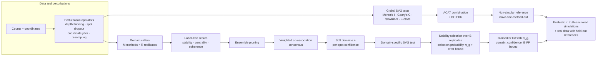
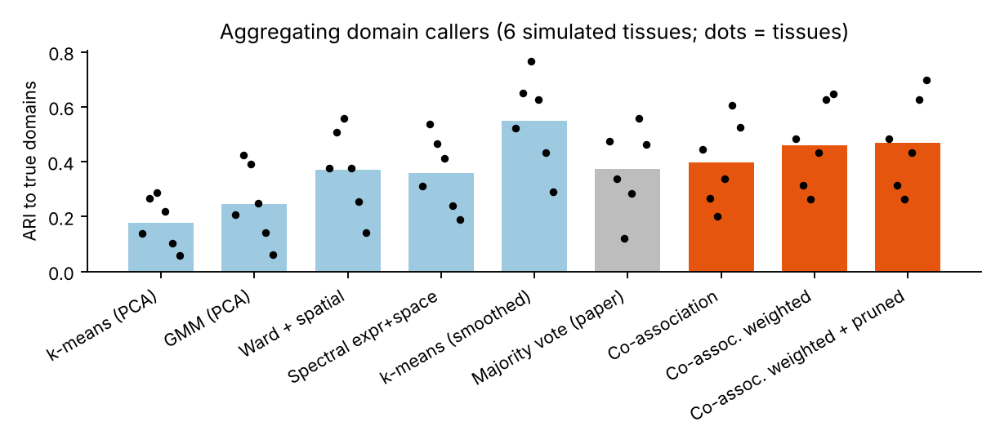
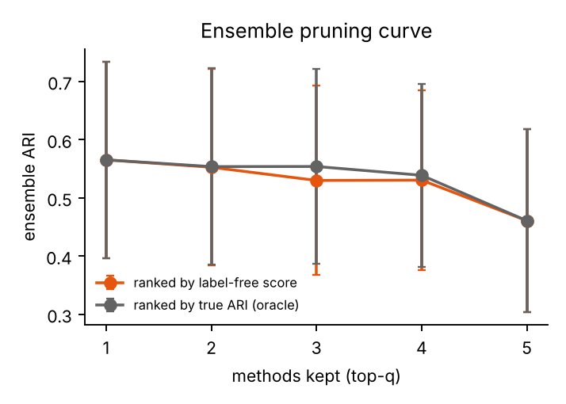
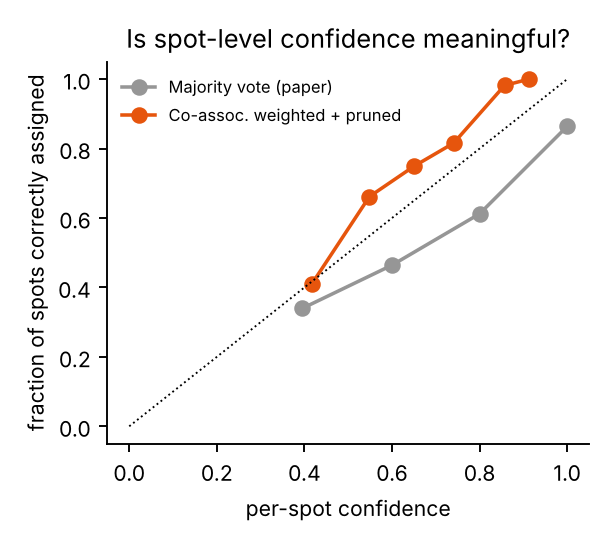
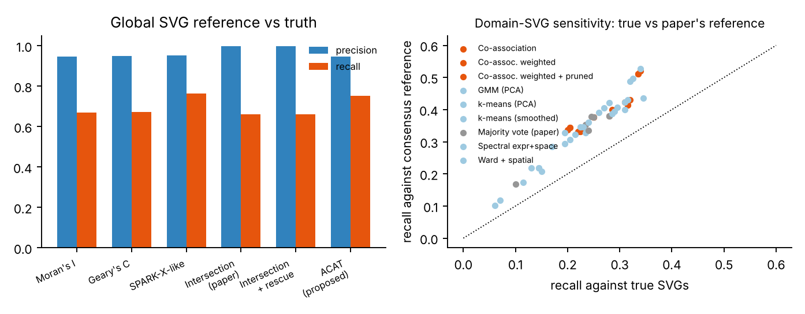
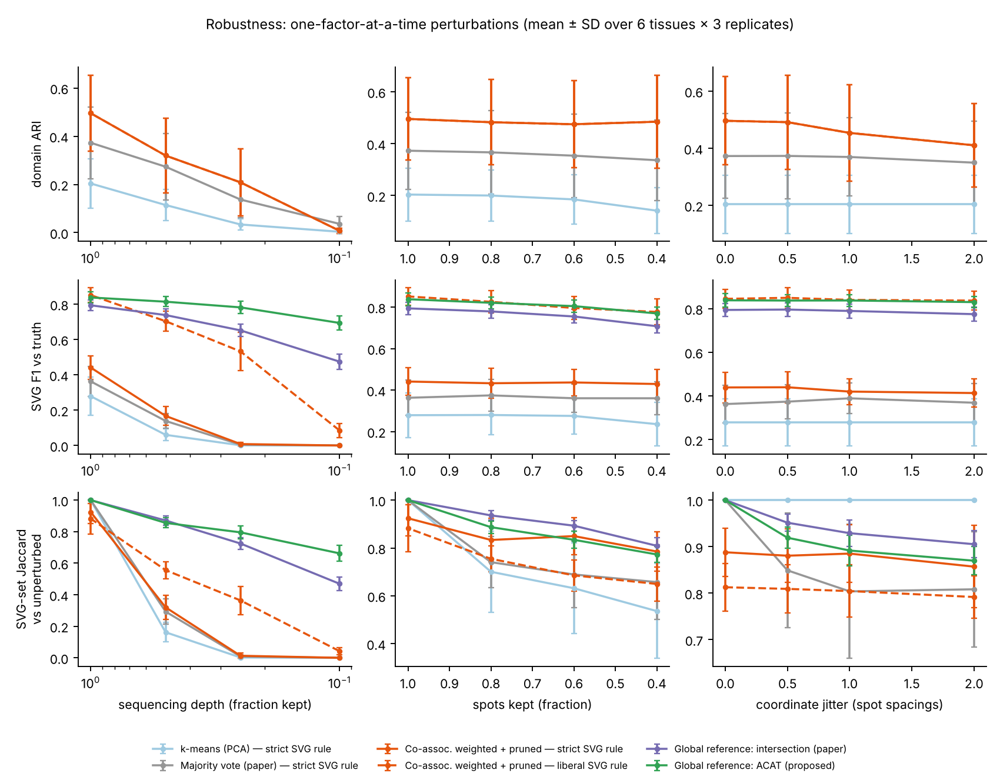
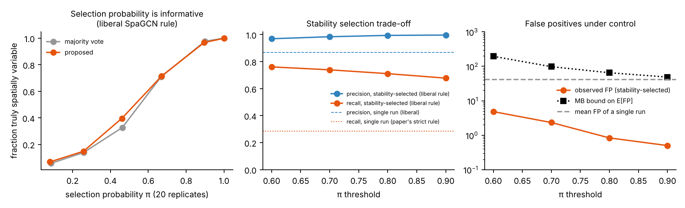

# Robust, uncertainty-aware benchmarking of spatial biomarker (SVG) identification

*Branch `spatial-svg-benchmark` · BIOINF 590 individual project · reference benchmark: Kang L., Zhang Q., Qian F., Liang J., Wu X. "Benchmarking computational methods for detecting spatial domains and domain-specific spatially variable genes from spatial transcriptomics data." **Nucleic Acids Research** 53, gkaf303 (2025).*

## Summary

Kang et al. (2025) showed three things:
- no spatial-domain method wins everywhere;
- domain-specific spatially variable genes (SVGs) depend on which domain map is used;
- a simple majority vote over 12 graph neural network (GNN) clustering methods gives more robust domains and SVGs.

But their evaluation has three weak points, and fixing each one is the basis of this project:
1. **Circular reference.** "True" SVGs on real data are a hard intersection of SPARK-X, nnSVG and Moran's I, plus genes added back by Moran's I. Moran's I is then reused as an evaluation metric.
2. **Hard, unweighted aggregation.** Every method's labels are aligned and majority-voted with equal weight, and no method is ever dropped.
3. **No uncertainty.** "Stability" is the spread of results across slices. No result comes with a confidence, and the benchmark ranking itself has no error bar.

I propose four new pieces:
- **(A)** a weighted co-association ensemble that gives each spot a confidence;
- **(B)** label-free method scores for weighting and **pruning** the ensemble;
- **(C)** a dependence-robust p-value combination (ACAT) to replace the intersection reference;
- **(D)** stability-selected SVGs, where each gene gets a selection probability and the list has a provable bound on expected false positives.

I also propose an experimental design that measures **robustness** (controlled perturbations) and **uncertainty** (bootstrap and stability) at every stage. A CPU-only pilot on simulated tissues (§5) already shows:
- **Ensemble vs vote:** the ensemble beats the paper's majority vote (domain ARI 0.47 vs 0.37, better in 5/6 tissues).
- **Pruning:** the label-free score finds the best method in every simulated tissue, and keeping only the top 1–2 methods lifts ARI further to about 0.56.
- **Reference bias:** the intersection reference misses a third of true SVGs and inflates apparent sensitivity by about 1.5×.
- **Robustness:** sequencing depth, not spot loss or coordinate error, is what breaks domain-specific SVG calling. At 25 % depth the paper's strict SpaGCN rule calls almost nothing (F1 0.36–0.44 → 0.00–0.02), while the ACAT global reference keeps 93 % of its F1.
- **Uncertainty:** combining a liberal SpaGCN rule with stability selection gives precision 0.98 at recall 0.74. The paper's strict rule gives precision 1.00 at recall 0.28. Each gene's selection probability is well calibrated (π ≈ 0.9–1.0 → 97–100 % true SVGs).

---

## 1. What the reference benchmark did, and the gaps it leaves

| Stage | Kang et al. (2025) | Gap | What this project does |
|---|---|---|---|
| Spatial domains | 19 methods, 30 real datasets (6 platforms) and 27 simulations, scored by ARI/NMI/AMI/SC | No single winner; GNNs are noise-sensitive on SeqFISH and Slide-seqV2 | Treat method choice as a source of uncertainty, not a choice to make once |
| Aggregating domains | Align labels, then majority vote over 12 GNNs (Fig. 6E–F) | Equal weights; bad methods still vote; hard labels; no confidence | **A + B:** weighted co-association consensus with label-free weights, pruning and per-spot confidence |
| Domain-specific SVGs | SpaGCN rule: p < 0.05, in-fraction ≥ 0.8, fold change ≥ 1.5 | Low sensitivity (mean 0.47); results swing with the thresholds (Fig. 5B) | Propagate domain uncertainty into SVG calls; report selection probabilities |
| Reference ("ground truth") on real data | Intersection of SPARK-X ∩ nnSVG ∩ Moran's I, plus Moran's I rescue | Covers < 50 % of true SVGs in their own simulation (Supp. Fig. S4b); circular with Moran's I scoring | **C:** ACAT-combined, FDR-controlled reference. Leave-one-method-out references. Truth-anchored simulations |
| Robustness | Variation across slices and datasets; hyperparameter sweeps | Never perturbs a dataset in a controlled way | Perturbation grid: depth, spot dropout, coordinate error, resolution, panel size, cell-type confounding |
| Uncertainty | None reported | Rankings and SVG lists come without error bars | **D:** stability selection with an error bound; bootstrap rank probabilities; calibrated spot confidence |

Other benchmarks of *global* SVG detection reached the same conclusion: methods disagree strongly and should be evaluated against known truth (Charitakis et al., *Genome Biol* 2023; Chen, Kim & Yang, *Genome Biol* 2024; Li et al., bioRxiv 2023). That motivates a design whose central object is the **disagreement**, measured and propagated, rather than a single winner.

## 2. The proposed framework



Every arrow that crosses the perturbation box is re-run B times. Every number the benchmark reports is a distribution, not a point.

## 3. Proposed methods

### A. Weighted co-association consensus (replaces the majority vote)

A *member* is one labelling: method *m* on replicate *r*, where a replicate is a seed and/or a perturbed copy of the data. The weighted co-association matrix is

```latex
C_{ij} = \frac{\sum_{(m,r)} w_m \,\mathbb{1}[\ell^{(m,r)}_i = \ell^{(m,r)}_j]}{\sum_{(m,r)} w_m}
```

It needs **no label alignment**: the paper's Hungarian/majority mapping is unstable when methods disagree on the number or shape of domains. Spectral clustering of *C* gives the consensus domains. For spot *i*, the soft membership in domain *k* is the mean of *C*<sub>*ij*</sub> over spots *j* in *k*, normalised. Its **confidence** is the largest membership. Confidence flags boundary spots and spots where methods disagree, and can be carried into the SVG test (soft domains).

### B. Label-free method scores, weights and **ensemble pruning**

Each method is scored without any ground truth:

| Score | Definition | Intuition |
|---|---|---|
| Stability *S<sub>m</sub>* | mean ARI between the method's own replicates | Unstable methods are mostly noise |
| Centrality *A<sub>m</sub>* | mean ARI to every other method's members | Idiosyncratic methods are likely wrong when most others agree |
| Spatial coherence *H<sub>m</sub>* | fraction of 6-NN spatial neighbours sharing a label | Tissue domains are contiguous; salt-and-pepper maps are suspect |

- **Weights:** *w<sub>m</sub>* = *S<sub>m</sub>* · *A<sub>m</sub>*.
- **Pruning:** methods are ranked by z(*S*) + z(*A*) + z(*H*). Two pruning rules are tested:
  1. drop methods more than *k* MADs below the median;
  2. keep the top *q*, with *q* chosen on held-out simulations.

  Pruning follows "many could be better than all" (Zhou et al. 2002). On real data, the pruned ensemble is checked against its held-out members.

### C. A calibrated global-SVG reference (replaces the intersection)

For each gene, the p-values from *T* SVG tests (SPARK-X, nnSVG, Moran's I, Geary's C, …) are combined with the **Cauchy combination test** (ACAT; Liu & Xie 2020):

```latex
T_g = \sum_{t=1}^{T} \frac{1}{T}\tan\{(0.5 - p_{g,t})\pi\}, \qquad p_g = 1 - F_{\mathrm{Cauchy}}(T_g)
```

This is valid under arbitrary dependence between tests, which matters because the tests share the same data. The combined p-values are then BH-adjusted. Unlike an intersection, ACAT keeps a gene that one powerful test detects strongly. To remove circularity, method *m* is evaluated against a reference built *without* *m* (**leave-one-method-out**), and Moran's I is never both a reference and a score.

### D. Stability-selected SVGs with an error guarantee

The full pipeline (perturb → domains → consensus → domain-SVG rule) is re-run on *B* replicates. Each spot-resampling replicate keeps 80 % of spots and 80 % of the reads and adds 0.3-spot coordinate noise. Each gene's selection probability is π<sub>g</sub> = (number of replicates calling *g*) / *B*. Genes with π<sub>g</sub> ≥ π<sub>thr</sub> are reported together with the Meinshausen–Bühlmann bound on expected false positives:

```latex
\mathbb{E}[V] \le \frac{q^2}{(2\pi_{\mathrm{thr}} - 1)\,p}
```

Here *q* is the mean number of genes called per replicate and *p* the number of genes tested. The biomarker list then carries a probability per gene, and the threshold can be chosen for a target error rate instead of being tuned (the paper's logFC/in-fraction dilemma).

### E. Uncertainty about the benchmark itself

The benchmark result is resampled at two levels: datasets (between-tissue) and replicates (within-tissue). From this the study reports **P(method is best)** and rank intervals. A mixed model, `metric ~ method + (1 | dataset) + (1 | dataset:replicate)`, splits variance into method, dataset and run-to-run components. This tells a user how much "which method" matters compared with "which dataset".

## 4. Experimental design

### 4.1 Data

| Arm | Data | Why |
|---|---|---|
| Truth-anchored simulation | (i) This repo's simulator: layered or blob domains, soft boundaries, NB counts, non-spatial cell states. (ii) scDesign3 and (iii) SRTsim fitted to DLPFC 151673 and a breast-cancer section, as in the paper | Known domains and SVGs; difficulty controlled by logFC, dispersion, boundary width, cell-state strength and depth |
| Real data, annotated | DLPFC 12 slices (Maynard et al. 2021); the paper's ST, Stereo-seq, STARmap, SeqFISH and Slide-seqV2 sets | Domains are known; SVGs are judged with leave-one-method-out references |
| Real data, semi-synthetic | Spike-in: implant a known domain-specific pattern into real null genes (shuffle-then-implant) | Real noise and real spatial covariance, with known truth |
| Negative controls | Toroidal shift or rotation of coordinates for real data | A spatial null preserving the expression distribution; checks false-positive rates |

### 4.2 Methods

- **Domain callers:** the paper's top performers (GraphST, BayesSpace, SpaGCN, STAGATE, CCST, Seurat/Leiden), plus this repo's CPU stand-ins for the pilot.
- **SVG tests:** SPARK-X, nnSVG, Moran's I, Geary's C, SpatialDE2, plus the SpaGCN domain rule.
- **Aggregators:**
  - the paper's majority vote and intersection;
  - the proposed CAC, weighted CAC and pruned CAC;
  - ACAT, robust rank aggregation and stability selection.

### 4.3 Robustness grid

Factors are varied one at a time around a baseline; a fractional factorial design covers interactions.

| Factor | Levels | Real-world counterpart |
|---|---|---|
| Sequencing depth (binomial thinning) | 1, 0.5, 0.25, 0.1 | Low-quality sections, shallow sequencing |
| Spot or cell dropout | 100, 80, 60, 40 % | Tissue damage, QC filtering, smaller sections |
| Coordinate error | 0, 0.5, 1, 2 spot spacings | Registration error, cell-segmentation shifts |
| Resolution | bin 1×1, 2×2, 4×4 | Visium HD / Stereo-seq bin sizes |
| Gene panel | whole transcriptome, 1,000, 300 genes | Imaging panels (MERFISH, Xenium) |
| Cell-type confounding | pattern via domain only vs via composition | Separating "spatially variable" from "cell-type marker" |
| Hyperparameters / seeds | 5 seeds; ±50 % around defaults | Run-to-run instability |

### 4.4 Metrics

| Question | Metric |
|---|---|
| Domains correct? | ARI / NMI to truth; per-spot accuracy |
| Is confidence meaningful? | Reliability curve (accuracy vs confidence); expected calibration error |
| SVGs correct? | Precision, recall, F1, AUPR against **truth**, reported separately from the consensus reference |
| Error control? | Observed FDR at nominal 5 %; false-positive rate under the toroidal null; observed FP vs the MB bound |
| Robust? | Metric retention = perturbed / unperturbed; Jaccard of the SVG set to the unperturbed set; area under the degradation curve |
| Stable? | Across-replicate Jaccard; selection-probability distribution |
| Agree? | The paper's agreement score (eq. 9); pairwise Kendall τ of gene rankings |
| How certain is the ranking? | P(best) from a two-level bootstrap; variance components from the mixed model |

### 4.5 Analysis plan

- **Primary comparison:** pruned CAC + ACAT + stability selection vs the paper's pipeline (majority vote + intersection + single run).
- **Paired design:** both pipelines run on the same datasets and replicates.
- **Effect sizes:** paired differences with bootstrap CIs over datasets. A Wilcoxon signed-rank test is used across datasets, with Holm correction across the pre-specified primary metrics: domain ARI, SVG F1 vs truth, SVG Jaccard under perturbation, and FDR.
- **Pre-registration:** the pruning rule and *q* are fixed on a development set of simulations before the evaluation set is touched. The pilot below *is* that development set.

## 5. Pilot results (simulated tissues, CPU only)

**Set-up.** Six simulated tissues: 3 layered and 3 blob layouts, each with 2,300 spots, 1,000 genes and 6 domains. Each tissue has 150 domain-specific SVGs (logFC 0.4–1.6), 50 global-gradient SVGs and 800 null genes, 100 of which follow non-spatial cell states. The simulator was tuned to the paper's regime:
- single-method ARI ranges from 0.06 to 0.77;
- the intersection reference recovers about 2/3 of true SVGs.

The five domain callers span expression-only and spatial designs (k-means and GMM on PCA; Ward with a spatial-contiguity constraint; spectral clustering on an expression + space graph; k-means on spatially smoothed PCs). Each runs on 5 replicates. Every test used here holds its nominal 5 % false-positive rate on spatially unstructured data (unit test, plus null false-positive rate = 0.051–0.057 in the pilot).

### 5.1 Aggregating domains: weighting helps; pruning helps more



| Approach | Mean ARI (95 % bootstrap CI over 6 tissues) |
|---|---|
| Best single method (k-means on smoothed PCs; known only in hindsight) | 0.548 (0.425–0.667) |
| Mean of the 5 single methods | 0.340 |
| **Majority vote (paper)** | **0.373 (0.257–0.480)** |
| Co-association, unweighted | 0.398 (0.289–0.510) |
| Co-association, label-free weights | 0.461 (0.353–0.577) |
| **Co-association, weighted + MAD pruning (proposed)** | **0.470 (0.354–0.594)** |

The proposed ensemble beats the majority vote by **+0.097 ARI (95 % CI 0.030–0.168), winning in 5/6 tissues**. It beats the average single method by +0.129. It still trails the best single method by 0.078, because the default MAD rule rarely pruned anything: it kept all five methods in 5/6 tissues. Weighting does most of the work: unweighted co-association gains only +0.025 over the majority vote.



**Pruning is where the remaining gain is.** Keep only the top-*q* methods by the label-free score:

| Methods kept (*q*) | 1 | 2 | 3 | 4 | 5 (all) |
|---|---|---|---|---|---|
| ARI, ranked by label-free score | **0.565** | 0.553 | 0.530 | 0.531 | 0.461 |
| ARI, ranked by true ARI (oracle) | 0.565 | 0.554 | 0.554 | 0.539 | 0.461 |

The label-free score picked the truly best method in **all 6 tissues**, and its curve tracks the oracle's. The co-association consensus of that one method's 5 replicates (0.565) also beats the method's average single run (0.548). In this pilot, "many could be better than all" holds in its strongest form: one or two well-chosen, replicate-averaged methods beat a five-method vote by about 0.19 ARI. The full study must fix *q* (or a score-gap rule) on development data before evaluation; this pilot is that development set.



**Spot confidence is informative in both ensembles, but in opposite directions:**
- **Majority vote:** the vote fraction is *over-confident*. Spots with ≥ 70 % of votes are right only 71 % of the time.
- **Co-association:** the membership is *under-confident* (conservative). Spots with confidence ≥ 0.7 are right 87 % of the time, versus 59 % below 0.7.

Either way, confidence separates trustworthy from doubtful spots. The proposed version errs on the safe side, which is what a downstream SVG test needs.

### 5.2 The intersection reference is biased, and ACAT fixes most of it



**Global reference quality vs truth** (mean of 6 tissues; 200 true SVGs out of 1,000 genes):

| Reference | Precision | Recall | AUPR |
|---|---|---|---|
| Moran's I | 0.946 | 0.670 | 0.835 |
| Geary's C | 0.948 | 0.672 | 0.835 |
| SPARK-X-like | 0.952 | 0.763 | 0.895 |
| **Intersection (paper)** | **0.997** | **0.660** | — |
| Intersection + Moran rescue | 0.997 | 0.660 | — |
| **ACAT (proposed)** | **0.947** | **0.752** | 0.890 |
| Rank aggregation (proposed, p-value-free) | — | — | 0.870 |

- **What the intersection costs:** it is almost perfectly precise but misses **34 % of true SVGs**, and the Moran rescue adds nothing here. ACAT recovers 9 points of recall. Its false-discovery proportion (5.3 %) matches the nominal 5 %. It matches the best single test without knowing in advance which test that is.
- **What the circular reference does:** scored against the intersection reference, every domain-SVG pipeline looks **1.49× more sensitive** than it is (range 1.26–1.68; recall 0.36 vs a true 0.24). The reference misses exactly the hard SVGs that the pipelines also miss. The *ranking* of pipelines is preserved (Kendall τ = 0.98), so the paper's relative conclusions are safe, but its absolute sensitivities are optimistic.
- **Agreement:** agreement between the five single methods' SVG sets (the paper's eq. 9) is 0.62, versus 0.23–0.45 in the paper's real data.

### 5.3 Robustness



F1 retention is the mean F1 over the perturbed levels divided by the unperturbed F1. Jaccard compares each perturbed SVG set with the unperturbed set.

| Factor | Pipeline | F1 retention | Jaccard |
|---|---|---|---|
| **Depth (0.5, 0.25, 0.1)** | Global reference: ACAT | **0.91** | **0.77** |
| | Global reference: intersection | 0.78 | 0.69 |
| | Domain SVGs, proposed ensemble, liberal rule | 0.52 | 0.32 |
| | Domain SVGs, majority vote, liberal rule | 0.58 | 0.30 |
| | Domain SVGs, either ensemble, strict (paper) rule | 0.13 | 0.10–0.11 |
| **Spot dropout (80, 60, 40 %)** | Proposed ensemble, strict / liberal | 0.98 / 0.94 | **0.82 / 0.70** |
| | Majority vote, strict / liberal | 1.01 / 0.93 | 0.70 / 0.59 |
| **Coordinate jitter (0.5–2 spacings)** | All pipelines that use coordinates | 0.97–1.04 | 0.75–0.93 |

- **Depth is the dominant threat.** The strict rule's fixed in-domain detection fraction (≥ 80 %) becomes impossible to meet once counts are thinned. At 25 % depth it calls almost no SVGs, whatever the domains. The global ACAT reference degrades gracefully. **Proposal:** make the domain-SVG rule depth-aware, e.g. test the in/out detection *difference* or use a calibrated effect size instead of an absolute fraction.
- **The ensemble keeps the domain map better at low depth:** ARI 0.21 vs 0.14 at 25 % depth.
- **Spot dropout:** the proposed ensemble's SVG set changes less than the majority vote's (Jaccard 0.82 vs 0.70 with the strict rule).
- **Coordinate jitter:** effects are small. Expression-only methods look perfectly "robust" to it only because they ignore coordinates, so invariance must not be mistaken for robustness.

### 5.4 Uncertainty: selection probabilities and the benchmark's own error bar



Twenty perturbation replicates per tissue, each keeping 80 % of spots and 80 % of reads, with 0.3-spacing coordinate noise and new seeds.

- **Selection probability is calibrated** (left). Genes with π ≈ 0.9–1.0 are 97–100 % true SVGs, π ≈ 0.45 about 35–40 %, and π < 0.25 at most 15 %. A biomarker list can therefore be ranked by π.
- **Stability selection beats threshold tuning** (middle). Liberal SpaGCN thresholds plus selection at π ≥ 0.7 give **precision 0.98 and recall 0.74**:
  - the single liberal run has precision 0.87 and recall 0.83;
  - the paper's strict rule has precision 1.00 but recall only 0.28.

  Stability selection therefore keeps almost all of the liberal rule's sensitivity while restoring strict-rule precision: about 2.6× the recall at ≥ 0.98 precision.
- **False positives are controlled** (right). Mean false positives fall from 41.6 per single liberal run to 2.3 at π ≥ 0.7 and 0.8 at π ≥ 0.8. The Meinshausen–Bühlmann bound holds everywhere but is very conservative (98 at π = 0.7). The full study will also test the tighter complementary-pairs bound (Shah & Samworth 2013).

**Uncertainty of the benchmark's own ranking.** Across 120 replicates (6 tissues × 20), one stand-in (k-means on smoothed PCs) ranked first every time, so P(best) = 1.0 and this pilot has no ranking uncertainty. That is a property of these deliberately varied stand-ins. With the real methods, which the paper finds close (mean ARI on 10x Visium: GraphST 0.55, STAGATE 0.52, CCST 0.48), the same two-level bootstrap will produce the rank intervals a user needs.

## 6. What changes for a user (practical recommendations if the full study confirms the pilot)

1. **Don't majority-vote domain callers.** Score them without labels (stability × agreement × spatial coherence), keep the top one or two, and take the co-association consensus of their replicates. Report per-spot confidence and pass it to the SVG test.
2. **Don't use an intersection of SVG tests as ground truth.** Use an ACAT-combined, FDR-controlled reference. Evaluate each method against a reference built without it. Expect intersection-based sensitivities to be inflated by roughly 1.5×.
3. **Don't tune logFC or in-fraction thresholds by eye.** Use permissive thresholds, re-run the pipeline on perturbed replicates, and report genes with selection probability ≥ 0.7 together with their π. This gave about 2.6× more true SVGs at the same precision as the strict defaults.
4. **Check depth first.** Fixed detection-fraction rules collapse on shallow data. Thin your own data to 50 % and see whether your SVG list survives; that is the cheapest robustness test there is.

## 7. Roadmap

| Phase | Work | Compute |
|---|---|---|
| 1. Done (this branch) | Simulator, CPU method stand-ins, aggregators, UQ, pilot | ~25 min on 2 CPU cores |
| 2 | Wrap the real methods (GraphST, BayesSpace, SpaGCN, STAGATE, SPARK-X, nnSVG) in containers; DLPFC 12 slices | 1 GPU-day for the GNNs; nnSVG ~hours per slice |
| 3 | Full perturbation grid on 6 platforms + semi-synthetic spike-ins; leave-one-method-out references | ~2–3 GPU-days |
| 4 | Mixed-model analysis, rank uncertainty, recommendations; release the pipeline as a Snakemake workflow | CPU |

## 8. Limitations of the pilot

- **Stand-in methods.** The domain callers and SVG tests are lightweight stand-ins; the "SPARK-X-like" test re-implements SPARK-X's covariance test, not the package. Absolute numbers will change with the real methods. The pilot's purpose is to show that the aggregation and UQ machinery works, and how large its effects can be.
- **No real data.** The real datasets on GitHub are stored with Git LFS, which this build environment cannot download, so the pilot has no real-data arm yet.
- **Small pilot.** Six tissues is a pilot. CIs are wide, and the pruning rule must be fixed before the evaluation study.

## References

- Kang L, Zhang Q, Qian F, Liang J, Wu X. Benchmarking computational methods for detecting spatial domains and domain-specific spatially variable genes from spatial transcriptomics data. *Nucleic Acids Res* 2025;53:gkaf303.
- Charitakis N, et al. Disparities in spatially variable gene calling highlight the need for benchmarking spatial transcriptomics methods. *Genome Biol* 2023;24:209. [link](https://genomebiology.biomedcentral.com/counter/pdf/10.1186/s13059-023-03045-1.pdf)
- Chen C, Kim HJ, Yang P. Evaluating spatially variable gene detection methods for spatial transcriptomics data. *Genome Biol* 2024;25:18. [link](https://GenomeBiology.biomedcentral.com/counter/pdf/10.1186/s13059-023-03145-y.pdf)
- Li Z, et al. Benchmarking computational methods to identify spatially variable genes and peaks. *bioRxiv* 2023. [link](https://www.biorxiv.org/content/10.1101/2023.12.02.569717.full.pdf)
- Benchmarking algorithms for spatially variable gene identification in spatial transcriptomics. *bioRxiv* 2024. [link](https://www.biorxiv.org/content/10.1101/2024.07.04.602147.full.pdf)
- Hu J, et al. SpaGCN: integrating gene expression, spatial location and histology to identify spatial domains and spatially variable genes by graph convolutional network. *Nat Methods* 2021.
- Zhu J, Sun S, Zhou X. SPARK-X: non-parametric modeling enables scalable and robust detection of spatial expression patterns for large spatial transcriptomic studies. *Genome Biol* 2021.
- Weber LM, et al. nnSVG for the scalable identification of spatially variable genes using nearest-neighbor Gaussian processes. *Nat Commun* 2023.
- Liu Y, Xie J. Cauchy combination test: a powerful test with analytic p-value calculation under arbitrary dependency structures. *J Am Stat Assoc* 2020.
- Meinshausen N, Bühlmann P. Stability selection. *J R Stat Soc B* 2010.
- Fred ALN, Jain AK. Combining multiple clusterings using evidence accumulation. *IEEE TPAMI* 2005.
- Strehl A, Ghosh J. Cluster ensembles — a knowledge reuse framework for combining multiple partitions. *JMLR* 2002.
- Zhou Z-H, Wu J, Tang W. Ensembling neural networks: many could be better than all. *Artif Intell* 2002.
- Kolde R, et al. Robust rank aggregation for gene list integration and meta-analysis. *Bioinformatics* 2012.
- Maynard KR, et al. Transcriptome-scale spatial gene expression in the human dorsolateral prefrontal cortex. *Nat Neurosci* 2021.
- Song D, et al. scDesign3 generates realistic in silico data for multimodal single-cell and spatial omics. *Nat Biotechnol* 2024.
- Zhu J, et al. SRTsim: spatial pattern preserving simulations for spatially resolved transcriptomics. *Genome Biol* 2023.
