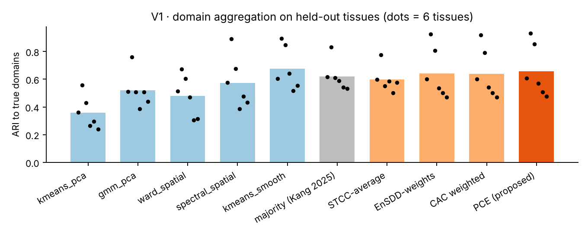
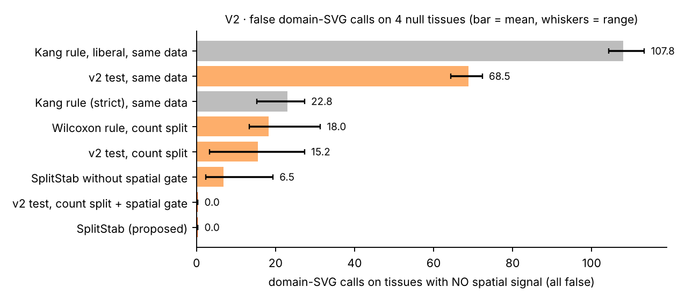
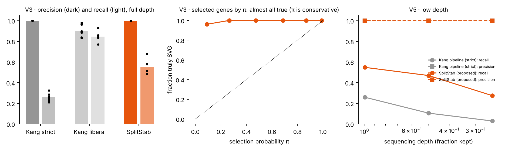
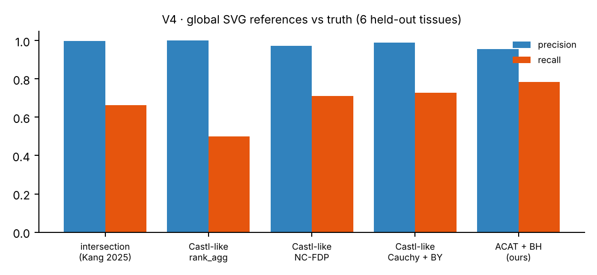

# Spatial SVG benchmark v2

**Gaps, expanded methods, held-out validation, and a Colab pipeline for real data (DLPFC)**

Branch `spatial-svg-benchmark` · follows [PROPOSAL.md](PROPOSAL.md) · reference benchmark: Kang et al., *NAR* 2025 (gkaf303)

## 0. Summary

| Question | Short answer |
|---|---|
| What does prior work already solve? | Ensemble domains with learned weights (EnSDD, STCC, SpatialESD). Robust *global* SVG aggregation with error control (Castl). Measuring per-spot domain instability (InSTability). Recognising double dipping in cluster → DE (ClusterDE, count splitting). |
| What is still open? | (1) Explicit, pre-registered **pruning** of bad members. (2) **Domain-specific** SVGs that are free of double dipping and of non-spatial cell-state confounding. (3) **Carrying domain uncertainty** into the marker test. (4) An **error rate** attached to domain-specific SVG lists. (5) Benchmark methodology: reference bias, perturbation robustness, replication. |
| What did we build? | **PCE** (pruned confidence-aware ensemble) for domains. **SplitStab** for domain-specific SVGs: count split → PCE → core spots → depth-aware NB test → spatial gate → repeat B times → negative-control-calibrated threshold. A real-data harness (R1–R6) on DLPFC and a Colab notebook. |
| What does validation show? | The big, reliable result is **SplitStab**: 0 false calls on null tissues (Kang rule: 23 strict / 108 liberal), precision 1.0 with **2× the recall** of the strict Kang pipeline, and 5–10× the recall at low depth. PCE is only modestly better than other ensembles and **not reliably better than majority vote**. For global SVGs, ACAT is close to Castl; the novelty there is small. |
| What still needs doing? | Run the Colab notebook on DLPFC. The GPU wrappers and the Hugging Face loader could not be executed in this sandbox. |

Everything in sections 4–5 is from simulations **held out** from method development (the pilot and pruning rule used seeds 1–3; validation uses seeds 4–6 and null seeds 21–24).

## 1. Gap analysis

| Work | What it does | What it leaves open (for this project) |
|---|---|---|
| **Kang et al. 2025** (reference) | Benchmarks 19 domain and SVG methods on simulated and real data. Majority-vote domains; SpaGCN rule for domain SVGs; intersection of methods as the global SVG reference. Notes that their pipeline can over-produce SVGs. | Same counts used to find domains and test markers (double dipping). No uncertainty on lists. The intersection reference rewards methods that are part of it. |
| **EnSDD** (2024) | Ensemble of domain methods; learns member weights by an entropy-regularised objective on a consensus similarity matrix. | Weights are soft: a bad method keeps a non-zero weight. No per-spot confidence passed downstream. Markers tested on the same data. |
| **STCC** (2024) | Consensus clustering of domain results (average, hypergraph, etc.). | No weighting or pruning; no downstream marker inference. |
| **SpatialESD** | Ensemble domain detection with method selection. | Selection is not pre-registered; no marker error control. |
| **Castl** (2025) | Aggregates *global* SVG methods by rank, Cauchy p-value combination, or permutation negative controls with FDP estimation. | Global only: says which genes are spatial, not which domain they mark. Permuted controls lose the depth structure (we show this matters). |
| **InSTability** | Shows that domain labels are unstable per spot and that this propagates into DE. | Measures, does not correct. |
| **ClusterDE / count splitting** (Neufeld et al. 2023–24) | Valid post-clustering DE by synthetic nulls or by splitting counts into independent halves. | Not spatial: a gene that differs between clusters that track *cell states* is still called. |

**Where our methods sit.** PCE overlaps EnSDD/STCC; its additions are hard, pre-registered pruning and a per-spot confidence that is used downstream. SplitStab is the main contribution: no prior method combines count splitting, uncertainty-aware (core-spot) testing, a spatial gate, and stability selection with calibrated negative controls for **domain-specific** SVGs. On the global side, ACAT + BH is essentially a Castl variant, so we treat it as a baseline and a sanity check, not a contribution.

## 2. Expanded methods

### 2.1 PCE: pruned confidence-aware ensemble (domains)

1. **Members.** Run each domain method $m$ on $R$ replicates (replicate 1 on the data as is; later replicates use binomial thinning 0.8 + small coordinate jitter, so member stability reflects robustness and not just seeds).
2. **Label-free scores** per method: *stability* (mean ARI across its replicates), *centrality* (mean ARI to other methods), *spatial coherence* (fraction of kNN neighbours sharing a label). Each is z-scored across methods and averaged.
3. **Pre-registered gap pruning.** Sort scores. Cut at the first gap of more than $\delta = 1.0$ z between consecutive methods, keeping between 2 and 3 methods. The rule was fixed on pilot seeds and never tuned on validation data.
4. **Consensus.** Weighted co-association $C_{ij} = \sum_m w_m \,\overline{\mathbb 1[l^m_i = l^m_j]}$ over kept members; labels by spectral clustering on $C$ with spatial smoothing; aligned to the best kept member.
5. **Per-spot confidence** $c_i$ = weighted share of kept member runs that agree with the consensus label. Spots with $c_i \ge 0.6$ are **core spots**.

Baselines implemented next to it: majority vote (Kang), STCC-average (k-means on $C$, unweighted), EnSDD-weights (closed-form alternating updates of the entropy-regularised objective), CAC weighted (our weights, no pruning).

### 2.2 SplitStab: domain-specific SVGs with an error rate

For $b = 1, \dots, B$:

1. **Subsample** 80 % of spots.
2. **Count split** ($\varepsilon = 0.5$): $X^{(1)} \mid X \sim \text{BetaBinomial}(X, \varepsilon\beta_g, (1-\varepsilon)\beta_g)$, $X^{(2)} = X - X^{(1)}$, with gene-wise NB size $\beta_g$ estimated by moments on size-factor-normalised counts. For NB data the two halves are independent, so a test on $X^{(2)}$ cannot see the clustering's choices.
3. **Domains** from PCE on $X^{(1)}$, with per-spot confidence.
4. **Test on core spots of $X^{(2)}$** with a depth-offset NB Wald rate test. For gene $g$ and domain $d$, rates $r = \sum X / \sum s$ inside and outside ($s$ = size factors from $X^{(2)}$),
   $$\operatorname{Var}\log r \approx \frac{1}{r S} + \frac{\sum s^2}{\beta_g S^2},\qquad z = \frac{\log r_\text{in} - \log r_\text{out}}{\sqrt{V_\text{in}+V_\text{out}}}$$
   One-sided, BH per domain; call if $q<0.05$, rate ratio $\ge 1.5$ and the gene is expressed (above the 10 % rate quantile). Replaces the Kang/SpaGCN rule's fixed "detected in ≥ 80 % of in-domain spots", which collapses at low depth.
5. **Spatial gate.** On $X^{(2)}$, ACAT of Moran's I and a SPARK-X-like kernel test, BH; require $q<0.05$.
6. **Negative controls.** 10 % extra synthetic genes drawn NB$(\mu_g s_i, \beta_g)$ from real genes' means and dispersions and the **real** per-spot size factors. They carry depth structure but no biology.

Then each gene has a selection probability $\pi_g$ (share of replicates in which it is called for any domain) and each control has $\pi_\text{nc}$. The threshold is the smallest $t \in \{0.5, 0.55, \dots, 1\}$ with

$$\widehat{\text{FDP}}(t) = \frac{\#\{\text{NC}: \pi \ge t\}\cdot G/G_\text{nc}}{\max(1, \#\{\text{genes}: \pi \ge t\})} \le \alpha = 0.1 .$$

The Meinshausen–Bühlmann bound is reported alongside. Each selected gene gets its **modal domain** across replicates.

**Why the spatial gate was added (a finding, not a plan).** In the first validation run count splitting alone still gave 13–31 false calls per null tissue. Every one was a non-spatial *cell-state* gene: domain callers partly cluster by cell state, so those genes really do differ between clusters, even on independent counts. Count splitting fixes double dipping but not this confound; only a spatial requirement does. Permuted negative controls also under-estimated false calls because permuting removes the depth association, which is why the controls are now synthetic NB with real size factors.

### 2.3 Global SVG references

Implemented: Kang intersection (with rescue), ACAT + BH over Moran's I, Geary's C and SPARK-X-like, and Castl-like rank aggregation, Cauchy + BY, and negative-control FDP. A leave-one-out reference checks how much a method is flattered by being part of its own reference.

## 3. Code map (new in v2)

| Path | Role |
|---|---|
| `stbench/splitting.py` | NB size estimation, Poisson/NB count splitting |
| `stbench/domain_svg.py` | NB offset test, Wilcoxon v1 rule, spatial gate, negative controls, NC-calibrated threshold, MB bound |
| `stbench/ensemble.py` | + EnSDD weights, STCC average, gap pruning, `pce`, `run_all_ensembles` |
| `stbench/workflow.py` | `Context`, member runs, `splitstab`, `paper_pipeline` (Kang baseline) |
| `stbench/svg_aggregate.py` | + Castl-like aggregation, leave-one-out reference |
| `stbench/real/io.py` | DLPFC loaders (Hugging Face → SODB → local h5ad), label detection, raw-count checks |
| `stbench/real/gpu_methods.py` | GraphST, STAGATE (PyG), SpaGCN wrappers; embeddings clustered with tied-covariance GMM (mclust EEE analogue) |
| `stbench/real/evaluate.py` | Real-data experiments R1–R6 |
| `scripts/run_real.py`, `scripts/report_real.py` | Driver with per-slice checkpoints; self-contained `report.html` |
| `scripts/run_validation.py`, `scripts/make_validation_figures.py` | Held-out validation V1–V5 |
| `configs/*.json` | `real_quick`, `real_gpu_quick`, `real_full`, `sim_test` |
| `notebooks/colab_spatial_svg_benchmark.ipynb` | Colab runner |
| `tests/test_v2.py` | Unit tests (split independence, null calibration, gate, thresholds, PCE) |
| `results/sim_pipeline_demo/report.html` | Example of the report the Colab run produces (on simulated slices) |

## 4. Held-out validation results

### V1 · Domain aggregation (6 tissues: 3 layered, 3 blob)

| Approach | Mean ARI | PCE minus approach (95 % bootstrap CI) | PCE wins |
|---|---|---|---|
| best single (kmeans_smooth) | 0.677 | −0.019 | |
| **PCE (proposed)** | **0.657** | | |
| EnSDD-weights | 0.640 | +0.017 (0.006, 0.030) | 6/6 |
| CAC weighted (no pruning) | 0.637 | +0.020 (0.007, 0.037) | 6/6 |
| majority vote (Kang) | 0.620 | +0.037 (−0.034, 0.129) | 2/6 |
| STCC-average | 0.598 | +0.060 (−0.036, 0.175) | 4/6 |

Calibration of per-spot confidence: core spots ($c \ge 0.6$) are correct 77 % of the time vs 44 % for non-core spots, so confidence carries information. But ECE is 0.155 for PCE vs 0.058 for majority vote: PCE confidences are **under-confident** (too low for how often they are right).

**Interpretation.** Pruning gives a small but consistent gain over the same ensemble without pruning and over EnSDD (6/6 tissues). It does **not** reliably beat majority vote and does not beat the best single method. The honest claim is: PCE is a safe default when you don't know which method is best, and its confidence is useful for ranking spots, not as a calibrated probability.

### V2 · Double dipping and confounding (4 null tissues, no spatial genes at all)

Every call here is false.

| Pipeline | Mean false calls (range) |
|---|---|
| Kang rule, liberal (single run, same data) | 107.8 (104–113) |
| v2 NB test, same data | 68.5 (64–72) |
| Kang rule, strict (majority vote, same data) | 22.8 (15–27) |
| Wilcoxon rule, count split | 18.0 (13–31) |
| v2 NB test, count split | 15.2 (3–27) |
| SplitStab without spatial gate | 6.5 (2–19) |
| v2 NB test, count split + spatial gate | **0** |
| **SplitStab** | **0** |

**Interpretation.** Double dipping is large (same-data → split cuts false calls ~4×), but splitting alone is not enough because of cell-state clusters. Stability selection helps further, and the spatial gate removes the rest. This directly addresses the over-production of SVGs noted by Kang et al.

### V3/V5 · Signal tissues, full and reduced depth

| Depth | Pipeline | Calls | Precision | Recall |
|---|---|---|---|---|
| 1.0 | Kang strict | 52 | 1.00 | 0.26 |
| 1.0 | Kang liberal | 189 | 0.90 | 0.85 |
| 1.0 | **SplitStab** | 110 | **1.00** | **0.55** |
| 0.5 | Kang strict | 21 | 1.00 | 0.11 |
| 0.5 | Kang liberal | 154 | 0.86 | 0.66 |
| 0.5 | **SplitStab** | 94 | **1.00** | **0.47** |
| 0.25 | Kang strict | 6 | 1.00 | 0.03 |
| 0.25 | Kang liberal | 133 | 0.77 | 0.50 |
| 0.25 | **SplitStab** | 55 | **1.00** | **0.27** |

**Interpretation.** At matched precision (1.0), SplitStab finds ~2× as many true domain SVGs as the strict Kang pipeline at full depth and ~9× at 25 % depth, because the depth-aware relative rule does not need 80 % detection. The liberal rule has higher recall, but 10–24 % of its calls are false and it calls ~108 genes on tissues with no signal at all (V2). Our method does **not** inflate SVG counts; it trades some recall for an error guarantee.

Two caveats:
- The selected threshold was always the grid floor (0.5), and genes with any $\pi > 0$ were already ~96–100 % true. So the false-call control here comes mainly from splitting + gating per replicate, and the negative-control calibration was never binding. It is a safety net that will matter more on real data where depth and composition artefacts are richer.
- $\pi$ is conservative (not a calibrated probability). Use it to rank; use the threshold for the list.

### V4 · Global SVG references (6 tissues)

| Reference | Precision | Recall | F1 |
|---|---|---|---|
| intersection (Kang) | 0.999 | 0.664 | 0.797 |
| Castl-like rank | 1.000 | 0.500 | 0.667 |
| Castl-like NC-FDP | 0.974 | 0.712 | 0.820 |
| Castl-like Cauchy + BY | 0.989 | 0.729 | 0.839 |
| ACAT + BH | 0.956 | 0.785 | 0.861 |

**Interpretation.** The intersection reference is very precise but misses a third of true SVGs, so methods that find those genes are scored as "false positives" against it. p-value combination (ACAT or Castl's Cauchy) is better balanced. The difference between ACAT and Castl is small; we do not claim novelty here.

## 5. Real data: design and how to run

### 5.1 Why DLPFC

Human dorsolateral prefrontal cortex, 10x Visium, Maynard et al. 2021: 12 slices from 3 donors, each with manual annotation of six cortical layers + white matter. It is the most-used domain benchmark (used by Kang et al., EnSDD, STCC, GraphST, STAGATE, SpaGCN), it has known layer markers, and the slices come in **adjacent pairs** (10 µm apart), which gives a natural replication test.

Sources tried in order: (1) a local `.h5ad` you upload; (2) Hugging Face `han-shu/st_datasets` (`DLPFC/DLPFC_<id>.h5ad`); (3) SODB via `pysodb` (`maynard2021trans`). The loader checks for integer raw counts (from `layers['counts']`, `raw.X` or `X`) and finds the layer label column automatically.

### 5.2 Experiments

| ID | What | Readout | Supports our claim if… | Refutes it if… |
|---|---|---|---|---|
| R1 | Domain aggregation vs manual layers | ARI/NMI per method & ensemble; kept methods; P(best) by bootstrap over slices; confidence vs accuracy | PCE ≥ majority and EnSDD on most slices; core spots more accurate than non-core | PCE below majority on most slices, or pruning drops the best GPU method |
| R2 | Real-data null: genes resampled from a slice-calibrated NB with no spatial signal | False domain-SVG calls | SplitStab ≈ 0; Kang rule ≫ 0 | SplitStab > ~5 % of calls |
| R3 | Spike-in: real low-Moran genes boosted 1.5/2/3× inside one layer | Recall of spiked genes; false-call rate | SplitStab recall > Kang strict at matched false-call rate | Recall at or below Kang strict |
| R4 | Adjacent-slice replication | Jaccard / replication rate of lists between pairs | SplitStab lists replicate better than Kang lists of similar size | Lower replication |
| R5 | Perturbation: depth 0.5 / 0.25, 60 % spots | Jaccard with unperturbed list | SplitStab more stable than Kang rule | Less stable |
| R6 | Global references | Size, overlap, known layer markers recovered (e.g. *MBP, PCP4, SNAP25, MOBP, HPCAL1*) | ACAT/Castl recover more known markers than intersection | |

### 5.3 Running on Colab

Open: <https://colab.research.google.com/github/wpuzhu/BIOINF-590-Individual-Project/blob/spatial-svg-benchmark/spatial_benchmark/notebooks/colab_spatial_svg_benchmark.ipynb>

1. *Runtime → Change runtime type → T4 GPU* (only for `gpu_quick`/`full`).
2. Set `PROFILE` in the settings cell; set `USE_DRIVE = True` for `full` so it can resume.
3. *Run all*. The notebook installs dependencies, runs unit tests and a simulated end-to-end check, loads slice 151673 as a data check, runs the profile, shows `report.html` inline, and zips everything for download.

| Profile | Slices | Methods | Approx. time |
|---|---|---|---|
| `quick` | 151673 + 151674 | 5 CPU methods | ~30–45 min |
| `gpu_quick` | 151673 + 151674 | + GraphST, STAGATE, SpaGCN | ~1–1.5 h |
| `full` | all 12 (6 pairs) | CPU + GPU, B = 20 | ~8–12 h (resumable) |

Outputs per slice: `domain_svgs.csv` (gene, domain, π, selected), `global_svgs.csv`, `splitstab.json` (threshold, FDP table, MB bound, kept methods), `r2–r6` tables; overall `report.html`. If a GPU method fails to install it is logged and skipped, and the run continues with the rest.

Local run (no GPU): `python scripts/run_real.py --config configs/real_quick.json` (needs `anndata`, `scanpy`, `huggingface_hub`).

### 5.4 Reading the report

- **R1 table.** Look at whether PCE's kept methods include the GPU methods (on DLPFC GraphST/STAGATE usually beat k-means). If pruning drops them, the label-free score is misleading on real data — an important negative result.
- **SplitStab list.** Selected genes with modal domain; known DLPFC layer markers falling in the right layer is a qualitative check. Genes with high π but no layer pattern are worth inspecting for artefacts (e.g. mitochondrial genes, tissue-edge effects).
- **FDP table.** If the chosen threshold moves above 0.5 on real data, the negative controls are doing work that simulation did not need.
- **R2/R3 together** give the precision–recall picture on real tissue structure; R4/R5 give reproducibility.

## 6. Limitations

- **Untested here.** The sandbox had no `anndata`, `torch` or network access to data hosts, so the GPU wrappers and real-data loaders were written against the libraries' documented APIs but not executed. The pipeline logic was tested end-to-end on simulated slices through the same code path (`configs/sim_test.json`; example report in `results/sim_pipeline_demo/`). Expect to fix small API issues on first Colab run.
- **Data source.** The Hugging Face mirror has no license or dataset card; verify it matches the spatialLIBD release, or upload the official data yourself. SODB is the fallback.
- **Simulation dependence.** V1–V5 use our simulator (calibrated to Kang et al.'s regime). Real tissue has richer artefacts.
- **PCE.** Gains over majority vote are not significant; confidences are under-confident.
- **Recall.** SplitStab's error control costs recall versus the liberal rule; count splitting halves the counts available to each step.
- **Small number of tissues** (6 signal, 4 null), so CIs are wide.

## 7. References

- Kang et al. (2025). Benchmarking spatial domain detection and spatially variable gene identification. *Nucleic Acids Research*, gkaf303.
- Maynard et al. (2021). Transcriptome-scale spatial gene expression in the human dorsolateral prefrontal cortex. *Nature Neuroscience* 24, 425–436.
- Neufeld, Gao, Popp, Battle, Witten (2024). Inference after latent variable estimation for single-cell RNA sequencing data (count splitting). *Biostatistics*. Neufeld, Dharamshi, Gao, Witten (2023). Data thinning for convolution-closed distributions.
- Song et al. ClusterDE: a post-clustering differential expression method robust to false-positive inflation caused by double dipping.
- EnSDD: ensemble learning for spatial domain detection. STCC: consensus clustering for spatial transcriptomics. SpatialESD.
- Castl: robust aggregation of spatially variable gene detection methods with false-discovery control.
- InSTability: quantifying instability of spatial domain labels.
- Liu & Xie (2020). Cauchy combination test (ACAT). *JASA*.
- Meinshausen & Bühlmann (2010); Shah & Samworth (2013). Stability selection.
- Long et al. (2023) GraphST; Dong & Zhang (2022) STAGATE; Hu et al. (2021) SpaGCN; Zhu, Sun & Zhou (2021) SPARK-X.
